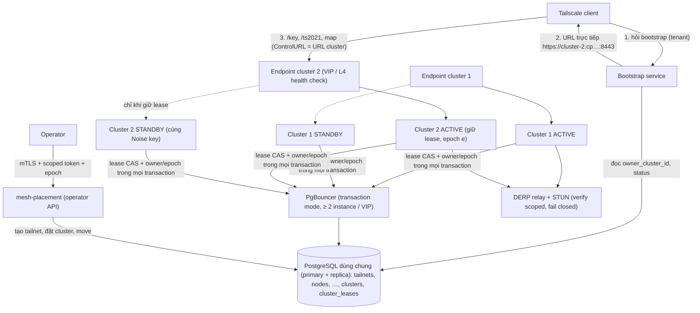

# KẾ HOẠCH TRIỂN KHAI — HEADSCALE NATIVE MULTI-TAILNET & CLUSTER

**Phiên bản:** 2.0 (22/11/2026) · **Ngôn ngữ:** Tiếng Việt · **Đối tượng:** AI coding agent + Go reviewer + security reviewer + lab operator.

> Bản 2.0 ghi lại kiến trúc cluster của chủ dự án ([ADR 0005](design/adr/0005-cluster-architecture-shared-postgres-bootstrap-incremental-netmap.md), kể cả "Bổ sung 2"):
> - **PostgreSQL dùng chung** cho mọi cluster;
> - **bootstrap** trả URL trực tiếp của cluster sở hữu tenant, không có hostname theo tenant;
> - **mỗi cluster một Noise key**;
> - mỗi cluster gồm **active + standby**, failover tự động bằng lease;
> - cô lập tenant **chỉ ở tầng ứng dụng**;
> - netmap tăng dần được phép khi có biện pháp bảo vệ.
>
> Các quyết định của bản 1.1 vẫn giữ: baseline v0.1, fresh schema, ID toàn cục, runtime theo tailnet, policy rỗng = DENY, shard classes và tenant migration trong MVP. Mục nào chưa ghi trạng thái khác thì vẫn là `Planned` cho tới khi có code và bằng chứng. Bản 1.1 (SQLite riêng mỗi shard, edge định tuyến theo Host, Noise key theo tailnet) nằm trong lịch sử Git; ADR 0001–0003 ghi phần nào đã bị thay.

## 0. Mục tiêu, giả định và tiêu chí thành công

### Phạm vi phải hoàn thành

1. **Hard fork** từ snapshot nhánh `main` của upstream Headscale (đang phát triển 0.30, migration upstream cuối `202611171200-node-key-expiry-disabled`). Không tồn tại tag `v0.29.7` trong checkout; dự án đánh version từ **v0.1**. Giữ provenance BSD-3-Clause. Bản vá bảo mật upstream được **cherry-pick thủ công** và ghi nhật ký (xem `evidence/source-inventory-P00.md` §1).
2. Một process quản lý **từ hai tailnet trở lên**. Mỗi tailnet có registry, identity, machine/node key, policy, routes, DNS, IP allocation, netmap và event stream độc lập, chạy trên **runtime riêng** (NodeStore, PolicyManager, Batcher, IPAM, authCache, cấu hình DERP/DNS). **Noise key thuộc về cluster** và dùng chung cho mọi runtime trong cluster. Không chỉ tạo nhiều Headscale `User`.
3. Client Tailscale thật đăng ký, đổi profile và duy trì kết nối cho các tailnet độc lập. Netmap **không chứa** peer hoặc private policy của tailnet khác, kể cả khi thiết bị/machine key/IP/hostname trùng nhau, và kể cả khi hai tailnet nằm trên **cùng cluster, cùng ControlURL, cùng Noise key**.
4. Nhiều **cluster** dùng chung một PostgreSQL. Mỗi tailnet có đúng một cluster sở hữu tại một thời điểm (`owner_cluster_id`, `owner_epoch` trên bảng `tailnets`). **Bootstrap** trả URL trực tiếp của cluster đó; cluster tự kiểm lại quyền sở hữu, không tin bootstrap. Chống split brain bằng epoch.
5. **Sẵn sàng trong một cluster:** mỗi cluster gồm một process **active** và một process **standby**, dùng chung Noise key của cluster. Lease của cluster nằm trong PostgreSQL và có TTL. Active chết hoặc treo thì standby **tự động** lấy lease với epoch mới; client reconnect với cùng key, **không đăng nhập lại**. Active cũ sống lại thấy epoch cũ và từ chối ghi.
6. **Mục tiêu dung lượng: multi-tenant.** Hai lớp shard (một shard = một cluster):
   - *shared*: nhiều tenant, mỗi tenant có hard quota **5.000 thiết bị**, cảnh báo ở 80% (4.000).
   - *dedicated*: một tenant, 5.000–10.000 thiết bị.

   Một tailnet **không bao giờ trải qua nhiều cluster**. Đây là mục tiêu, chưa phải năng lực. Theo P00b, với code upstream hiện tại một process chỉ phục vụ được khoảng **1.5k–2.5k thiết bị với policy thực tế** (`allow_all`, `personal_devices`), đo bằng client chạy trong cùng process (`evidence/P00b-capacity-baseline.md` §7). P00c đang tối ưu và đo **server-only**.
7. **Tenant migration giữa cluster trong MVP (P12b):** đổi chủ sở hữu (`owner_cluster_id`, `owner_epoch`) trong PostgreSQL, không copy dữ liệu. Cluster đích có URL và Noise key khác, nên client **phải gọi lại bootstrap, đổi ControlURL và đăng nhập lại**; thủ tục có thông báo trước. Chi tiết: [ADR 0003](design/adr/0003-shard-classes-and-tenant-migration.md), ADR 0005, `tickets/P12b.md`.
8. Test E2E chạy bằng lab VM/container tạo từ **Proxmox VE**, có IaC, traffic P2P và DERP fallback, negative security tests, failover tests, chaos testing và benchmark.
9. Mọi tính năng admin/observability/relay có bảo vệ đa tenant. Một process treo/crash không bị quảng bá là hard isolation.

### Không làm trong phạm vi này

- SaaS Portal, billing, multi-org UI, SCIM, production rollout; không tích hợp `network-access-mesh`.
- **Không nâng cấp từ database Headscale.** v0.1 dùng fresh schema; DB Headscale cũ bị từ chối khi khởi động.
- **Không có hostname ổn định theo tenant** (ADR 0005 Bổ sung 2). Chuyển tenant giữa cluster không giữ được ControlURL.
- Chuyển tenant giữa cluster **mà client không phải đăng nhập lại**, và zero-staleness: không thuộc MVP; để ở P16, chỉ sau một ADR mới.
- **Row-level security** của PostgreSQL và **role DB theo cluster**: không làm (ADR 0005 Bổ sung 2 §3). Rủi ro còn lại ghi ở `03-isolation-threat-model.md` §8.
- Phân tán **một tailnet** qua nhiều cluster; đơn vị placement là nguyên tailnet.
- Không cam kết "thiết bị không giới hạn" hoặc tăng tuyến tính theo số cluster khi chưa benchmark. 5.000/10.000 là quota và mục tiêu thiết kế, không phải capacity claim.
- SQLite cho production. SQLite chỉ dùng cho dev và unit test, với **cùng schema v0.1**.

### Definition of Done mức dự án

- `N1`: 2 tailnet/1 process (cùng Noise key cluster); các test xuyên tenant S01–S18 pass với Tailscale client thật.
- `N2`: 2 cluster, mỗi cluster có active + standby, trên một PostgreSQL dùng chung. 3+ tailnet được tạo và bootstrap trả đúng cluster. Không có ghi nhận owner kép. Failover active → standby tự động, client không đăng nhập lại (F01–F04). Một tailnet được chuyển cluster bằng P12b (re-bootstrap + đổi ControlURL + đăng nhập lại) mà không có owner kép.
- `N3`: HA PostgreSQL (primary + replica, failover có kiểm thử), backup/restore không làm lùi epoch, restart/reconnect, upgrade canary theo cluster, xoay Noise key cluster, dashboard giám sát và failure-mode tests pass.
- `N4`: load test các tổ hợp nhiều tailnet nhỏ / một tailnet lớn (so với baseline P00b/P00c) / reconnect storm / failover storm; report p50/p95/p99, RAM, CPU, DB writes và số kết nối PostgreSQL. Capacity limits được **đo** chứ không đoán.

## 1. Quyết định kỹ thuật (không nhầm với điều đã chứng minh)

| Chủ đề | Thiết kế | Cổng kiểm chứng |
|---|---|---|
| Baseline | Snapshot upstream `main` 0.30-dev (squash `2558340`, migration cuối `202611171200`), hard fork version **v0.1**. Không có tag `v0.29.7`. Cherry-pick thủ công bản vá bảo mật upstream | Commit hash, `PROVENANCE.md`, nhật ký cherry-pick, `go test ./...` trên Linux (`mc-ci`) |
| Source | Repo hiện tại; một module Go cho core; tách binary bằng `cmd/` | Baseline build/test trước khi đổi module/import path |
| Multi-tailnet | `TailnetID` là boundary bảo mật; `UserID` chỉ scoped bên trong tailnet | Test lộ node/policy/API/DNS/routes |
| Runtime theo tailnet | Mỗi tailnet có NodeStore, PolicyManager, Batcher, IPAM, authCache, cấu hình DERP/DNS riêng. Dùng chung trong process: pool DB (qua repo đã scoped), listeners, **Noise key của cluster**, lease client. Chi phí peer map lý thuyết Σnᵢ² thay vì (Σn)² ([ADR 0001](design/adr/0001-per-tailnet-runtime.md); phần Noise key đã bị ADR 0005 thay) | Không còn state toàn process keyed theo node/IP/key; benchmark P00c + L1–L4 |
| Storage | **Một PostgreSQL dùng chung cho mọi cluster** (ADR 0005). Fresh schema v0.1: `tailnet_id NOT NULL` trên mọi bảng tenant, composite FK, unique `(tailnet_id, …)`. SQLite chỉ cho dev/unit test, cùng schema. `versioncheck` từ chối DB Headscale cũ. HA PostgreSQL là yêu cầu N3 | Test transaction, FK/unique âm tính, schema SQLite ≡ PostgreSQL, failover PG |
| Connection pooling | **PgBouncer bắt buộc** trước PostgreSQL dùng chung ([ADR 0006](design/adr/0006-pgbouncer-connection-pooling.md)). Mọi process cluster (active và standby) kết nối qua PgBouncer; standby giữ pool tối thiểu 1–2. Đề xuất chế độ **transaction**, PgBouncer **≥ 1.21** với `max_prepared_statements > 0` (pgx của code hiện tại dùng prepared statement có tên; `= 0` thì lỗi ngay khi mở DB, đã đo). Cấm trạng thái phiên: chỉ `SET LOCAL`, chỉ `pg_advisory_xact_lock`, không `LISTEN/NOTIFY`, không bảng tạm. Lease và fencing chỉ dùng CAS/`FOR SHARE` trong transaction, qua **pool PgBouncer riêng** để không xếp hàng sau traffic dữ liệu (B2: lease poll p99 tới 651 ms qua pool dữ liệu bão hòa). Migration và giám sát đi đường trực tiếp. HA PgBouncer là yêu cầu N3 (P13) | B2 có/không PgBouncer (`evidence/P14-db-benchmarks.md`), negative test `max_prepared_statements=0`, kill PgBouncer khi đang tải (P13) |
| Cô lập dữ liệu | **Chỉ ở tầng ứng dụng:** plugin GORM fail-closed (thiếu scope → lỗi); kiểm owner + epoch trong cùng transaction; review tay mọi SQL thô; test/lint chặn SQL thô mới ngoài allowlist. **Không** RLS, **không** role DB theo cluster. Rủi ro còn lại được chấp nhận: lỗi app bỏ qua scope không có lớp chặn ở DB (ADR 0005 Bổ sung 2 §3) | Plugin tests (thiếu scope → `ErrNoScope`), lint SQL thô trong CI, test isolation âm tính |
| ID | NodeID và UserID **duy nhất toàn cục**, cấp bởi **sequence của PostgreSQL**, không tái sử dụng (StableNodeID = NodeID, `hscontrol/types/node.go:92`), giới hạn < 2^53. Thay cơ chế cấp khối ID của [ADR 0002](design/adr/0002-v0.1-fresh-schema-and-global-ids.md) mục 4 | Hai cluster ghi đồng thời không trùng ID; ID đã xóa không tái dùng |
| Registry | **Nằm trong cùng PostgreSQL dùng chung**: bảng `clusters`, `cluster_leases`, và cột `owner_cluster_id`, `owner_epoch` trên `tailnets`. Package `internal/placement`; API operator `cmd/mesh-placement` | CAS, fencing, stale-epoch tests (P10) |
| Default policy | Khi tạo tailnet, ghi **cùng transaction** policy `{"grants":[]}` và `PENDING`. Với tailnet tenant, policy nil/rỗng/`{}` = **DENY** (P03a, đã merge). Không fallback allow-all khi parse lỗi | Concurrency test: không có cửa sổ allow-all; round-trip policy rỗng vẫn deny |
| Endpoint | **Bootstrap** (`internal/bootstrap`, `cmd/mesh-bootstrap`) trả **URL trực tiếp của cluster** sở hữu tenant, ví dụ `https://cluster-2.cp.gta5web.online:8443`; client kết nối thẳng tới đó. **Không** hostname theo tenant, **không** edge định tuyến theo Host. Bootstrap từ chối `MOVING`/`SUSPENDED`; cluster tự kiểm lại quyền sở hữu | F06–F07 + client thật (P11) |
| Noise identity | **Một Noise key cho mỗi cluster**, dùng chung cho mọi tenant trên cluster và cho cả active lẫn standby. Ranh giới tenant của phiên: credential đăng ký gắn tailnet → bản ghi node `(machine_key, node_key)` → `tailnet_id`; scope fail-closed. POC P02 (key theo tenant, chọn theo Host) giữ làm hồ sơ | S05, S10, S11 với client thật; xoay key cluster là gate N3 |
| OIDC | N1 dùng signed tenant-bound enrollment token + web approval tối thiểu; chưa bật OIDC upstream global | Replay, cross-tenant approve & expiry tests |
| DERP | DERP external có verify scoped; embedded DERP **disabled** cho tới khi audit xong | Relay data/security/DoS test và verify fail-closed |
| Sharding | Shard = cluster. Một tailnet chỉ có một cluster sở hữu và không trải qua nhiều cluster. Hai lớp: *shared* (quota 5.000/tenant, cảnh báo 80%) và *dedicated* (một tenant, 5k–10k) ([ADR 0003](design/adr/0003-shard-classes-and-tenant-migration.md)) | Owner/epoch tests, quota enforcement, số đo P00b/P00c |
| Runtime HA | Mỗi cluster = active + standby. Lease cluster trong PostgreSQL, TTL đánh giá bằng `now()` của DB. Standby tự lấy lease với epoch mới. Active cũ tự fence (đồng hồ monotonic) và bị fence ở DB (epoch). Failover không đổi `owner_epoch` của tenant (ADR 0005 Bổ sung 2 §2) | F01–F05 (P11b) |
| Migration | Chuyển tenant giữa cluster = đổi `owner_cluster_id` + tăng `owner_epoch` trong một transaction; không copy dữ liệu. Có thông báo trước; client re-bootstrap, đổi ControlURL, đăng nhập lại. State trong bộ nhớ không mang theo. Zero-staleness và "không đăng nhập lại" để ở P16 | Không owner kép, NodeID giữ nguyên trong DB, đo thời gian đăng nhập lại (P12b) |
| Netmap | Được phép **cập nhật peer map tăng dần** và gửi delta chỉ tới node bị ảnh hưởng. Biện pháp bắt buộc: equivalence test (`rapid`) so với full rebuild; đổi policy luôn full rebuild; đối chiếu định kỳ khi chạy, lệch thì thay bằng full rebuild; delta thu hồi luôn gửi + full map định kỳ; **công tắc mặc định OFF** cho tới khi review; E2E thu hồi với client thật (P00d) | M01–M06 |

**Chú ý về Noise (AGENTS rule 12):** chủ dự án đã quyết định tường minh một key cho mỗi cluster (ADR 0005). Agent không tự đổi sang thiết kế khác (key theo tenant, trial-decrypt nhiều key, …). Nếu client thật cho thấy hành vi không tương thích với key dùng chung (ví dụ trộn hai profile cùng ControlURL), dừng PR, ghi ADR kèm log protocol đã redact và chờ duyệt.

## 2. Cấu trúc repository mục tiêu

```text
mesh-controlplane/
├── cmd/
│   ├── mesh-controlplane/      # binary của cluster (active hoặc standby, cùng binary)
│   ├── mesh-bootstrap/         # dịch vụ bootstrap: tenant → URL cluster (P11)
│   ├── mesh-placement/         # API operator: tạo tailnet, đặt cluster, move (P10)
│   ├── gen-openapi/            # upstream: sinh OpenAPI từ Huma
│   └── hi/                     # integration harness upstream
├── hscontrol/                 # bắt đầu từ upstream, refactor từng lớp
│   ├── state/                 # runtime theo tailnet, NodeStore, sự kiện
│   ├── db/                    # fresh schema v0.1 (PostgreSQL + SQLite dev), migration
│   │   └── tenantscope/       # plugin GORM fail-closed (P03b)
│   ├── mapper/                # MapResponse + delta + stream scoped; netmap tăng dần (P00d)
│   ├── policy/v2/             # engine policy theo tailnet
│   ├── frontdoor/             # P02: chuẩn hóa Host/SNI; nay = allowlist hostname của cluster
│   ├── scope/                 # upstream: OAuth scope của API v2 (KHÔNG phải tailnet scope)
│   ├── servertest/            # upstream: TestScale, test server in-memory
│   ├── dns/  routes/  derp/   # cấm global tenant-confused settings
│   └── ...
├── internal/
│   ├── tailnet/               # TailnetID, VerifiedScope, context, authorization
│   ├── placement/             # clusters, owner/epoch, CAS, shard class, quota (P10)
│   ├── lease/                 # lease cluster, fencing token, self-fence (P11b)
│   ├── bootstrap/             # tra owner, từ chối MOVING/SUSPENDED (P11)
│   └── controlapi/            # tenant-scoped admin API
├── tools/capload/             # P00c: load generator server-only
├── integration/               # harness Tailscale thật
├── infra/lab/                 # OpenTofu, cloud-init, Ansible, scripts, e2e
├── design/adr/                # ADR của fork
├── tickets/                   # ticket Pxx
├── evidence/                  # source-inventory-Pxx.md và bằng chứng PR
├── docs/                      # upstream mkdocs (giữ nguyên)
├── gen/client/v1|v2/          # client sinh bởi oapi-codegen; không sửa tay
├── go.mod  go.sum
└── AGENTS.md
```

**Lưu ý tên package:** `hscontrol/scope` đã tồn tại và là OAuth scope của API v2 (`scope.Scope`), không liên quan tới tailnet. Kiểu tailnet (`TailnetID`, `VerifiedScope`, helper context) đặt ở `internal/tailnet`. Tên package mới (`internal/lease`, `internal/bootstrap`, `hscontrol/db/tenantscope`) là đề xuất; ticket chốt sau khi đọc source.

**Front door và `serve-tailnets` (P02):**
- `hscontrol/frontdoor` được **giữ** làm lớp kiểm Host/SNI của listener cluster (allowlist hostname của cluster, 421 fail closed). Nó không còn chọn tailnet theo Host.
- `headscale serve-tailnets` (N runtime, mỗi runtime một DB và một key) **deprecated**. Vẫn chạy trên `mc-cp` vì endpoint public và harness E2E P02 đang dùng và chưa có thay thế. Không thêm tính năng. Gỡ trong P05 hoặc ngay sau P09, kèm cập nhật harness (ADR 0005 Bổ sung 2 §5).

**Codegen:** repo không có `proto/`. API dùng Huma + OpenAPI: `make openapi` (`cmd/gen-openapi`) xuất spec, `make generate` sinh code và gọi `make client` để tạo `gen/client/v1/client.gen.go`, `gen/client/v2/client.gen.go` (oapi-codegen được pin trong `Makefile`).

**Tài liệu dự án:** các file `03-…06-*.md`, `PLAN.md`, `HANDOFF_PROMPT.md` nằm ở root. `docs/` là tài liệu mkdocs của upstream.

Không bắt đầu bằng thao tác `sed` toàn bộ import của Headscale. `go.mod` ghi `go 1.27.4` (không có dòng `toolchain`); phải dùng Go theo checkout, **không dùng Go 1.23 hệ thống**.

## 3. Sơ đồ hoạt động và trust boundary



Bên trong mỗi process active, listener nhận request, kiểm Host thuộc cluster, rồi chọn **runtime của đúng tailnet** theo scope đã xác thực (credential đăng ký hoặc bản ghi node). Các runtime không chia sẻ NodeStore, PolicyManager, Batcher hay cache. Chúng chỉ dùng chung Noise key của cluster, listener và pool PostgreSQL. Pool của process nối tới **PgBouncer**, không nối thẳng tới primary (ADR 0006); `mesh-placement` và migration dùng kết nối trực tiếp hoặc pool `session` riêng.

### Quy tắc định tuyến và xác thực

1. **Bootstrap** chỉ trả URL của cluster đang sở hữu tenant (`owner_cluster_id`) khi tenant `ACTIVE`. `MOVING`, `SUSPENDED`, `PENDING`, `DELETING` và tenant không tồn tại bị từ chối, với phản hồi không làm lộ sự tồn tại của tenant cho caller không có credential (I15). Bootstrap không nằm trên đường dữ liệu và **không** là nguồn tin cậy của cluster.
2. **Listener cluster** chỉ chấp nhận Host thuộc allowlist hostname của cluster (chuẩn hóa: lowercase, bỏ port, bỏ dấu chấm cuối; trên TLS thì SNI == Host). Host lạ → 421. Không chấp nhận header client tự gửi như `X-Tailnet-ID`. Listener phải phục vụ hoặc từ chối rõ ràng `/ts2021` trên cổng 80 (client thử cổng 80 trước, `infra/lab/README.md`).
3. **Gắn tenant cho phiên (I01):**
   - register lấy `tailnet_id` từ credential đăng ký (pre-auth key, enrollment token, phê duyệt web);
   - map/poll lấy `tailnet_id` từ bản ghi node khớp **đúng một** `(machine_key, node_key)`; không có hoặc nhiều hơn một bản ghi → fail closed;
   - khi phiên Noise đã gắn một tailnet, mọi request sau trên phiên đó phải cùng tailnet;
   - `tailnet_id` trong payload client chỉ để đối chiếu.
4. **Quyền sở hữu và fencing:** trước khi phục vụ, runtime kiểm `owner_cluster_id` = cluster mình và lease cluster còn hiệu lực ở epoch của mình. Mọi mutation kiểm lại cả hai trong cùng transaction. Process không giữ lease (standby, hoặc active cũ) không phát MapResponse và không ghi.
5. Khi đăng ký qua browser, trạng thái pending phải gắn tailnet, requester, hashed machine/node identity, nonce, time-bound claim và single-use approval.
6. API admin yêu cầu mTLS service identity + credential scoped tailnet + operation + epoch (và idempotency key cho mutate). Quyền platform operator tách hoàn toàn khỏi token tenant.

## 4. Data model / migration: fresh schema v0.1 trên PostgreSQL dùng chung

v0.1 **không** thêm migration vào cuối chuỗi upstream. Fork mở **chuỗi migration mới** (bắt đầu `202611220000-v0.1-init`) với schema có `tailnet_id` ngay từ đầu; không có đường nâng cấp từ DB Headscale. Storage production là **PostgreSQL dùng chung**; SQLite chỉ cho dev/unit test với cùng schema. Chi tiết: [ADR 0002](design/adr/0002-v0.1-fresh-schema-and-global-ids.md), ADR 0005, `evidence/source-inventory-P03b.md`.

**Bảng dự kiến:**
- Tenant: `tailnets(id, slug, status, owner_cluster_id, owner_epoch, policy_revision, config_revision, created_at, updated_at, deleted_at)`, `tailnet_settings`, `tailnet_policies`, `tailnet_events` (revision log), `tailnet_keys` (key inventory), `pending_registrations`, `audit_events`, và `users`, `nodes`, `credentials`, routes, SSH-related authority. Mọi bảng tenant có `tailnet_id NOT NULL`.
- Nền tảng (không có `tailnet_id`; chỉ truy cập qua API platform operator hoặc lease client): `clusters(id, endpoint_url, class, state, noise_public_key, …)`, `cluster_leases(cluster_id, holder, epoch, expires_at)`.

Tên thật chốt trong P03b/P10 sau khi audit `hscontrol/db/schema.sql`.

**Invariants bắt buộc:**

- Mọi bảng tenant có `tailnet_id NOT NULL`; test introspection kiểm.
- Unique theo `(tailnet_id, …)` thay cho unique toàn cục của upstream (`users.name`, `provider_identifier` ở `schema.sql:37-39`). `credentials(kind, identifier)` giữ unique toàn cục (identifier ngẫu nhiên; lookup luôn kiểm tailnet). Index `(tailnet_id, machine_key)`; có unique hay không do reviewer chốt (inventory P03b §5).
- **Phân giải tenant theo node:** `(machine_key, node_key)` phải xác định **tối đa một** node trên toàn DB (unique, hoặc tra cứu fail-closed khi có nhiều hơn một; chốt ở P03b/P04). Đây là cơ sở của I01 khi nhiều tenant dùng chung ControlURL và Noise key.
- Mọi FK tenant-sensitive là composite `(tailnet_id, entity_id)` hoặc có trigger tương đương (ví dụ `credentials.user_id` với `ON DELETE SET NULL`). Node A không thể dùng `user_id` thuộc B.
- **NodeID và UserID** cấp từ sequence PostgreSQL: duy nhất toàn cục, không tái sử dụng, < 2^53. SQLite dev dùng cùng ràng buộc nhưng không dùng để chứng minh tính toàn cục.
- `owner_cluster_id`, `owner_epoch` chỉ nằm trên `tailnets`, **không** trên từng dòng dữ liệu. `owner_epoch` tăng đơn điệu, không bao giờ giảm, kể cả sau restore (giữ high-water mark ngoài backup, P13).
- Mọi mutation dữ liệu tenant kiểm, trong **cùng transaction**:
  - `tailnets.owner_cluster_id` = cluster mình và `owner_epoch` = epoch mình biết;
  - lease cluster: `holder` = process mình, `epoch` = epoch lease, `expires_at > now()`, đọc với khóa chia sẻ để takeover phải chờ các transaction đang chạy.

  Sai → rollback và process tự fence (I12).
- `CreateTailnet` ghi `{"grants":[]}`, settings, status `PENDING` và owner ban đầu **trong cùng transaction**. `Activate` chỉ sau khi engine policy nhận default-deny.
- Runtime theo tailnet: NodeStore, event channel, mapper subscriber, DNS, IPAM, route lookup và policy evaluator thuộc runtime của tailnet. Cấm cache toàn process keyed chỉ bởi name/IP/machine-key.
- IP trùng nhau giữa các tailnet có thể hợp lệ; test overlap địa chỉ VPN và subnet route.
- **SQL thô** (`Raw`, `Exec`, SQL trong migration) không qua plugin scope. Mỗi câu được review tay và ghi vào inventory; test/lint trong CI đánh dấu câu mới ngoài allowlist.
- `versioncheck` từ chối DB Headscale cũ (có migration upstream, không có marker v0.1) với lỗi rõ ràng.
- Migration của fork: đã commit thì không sửa, không reorder, chỉ thêm vào cuối; không `AutoMigrate` trong migration, không disable FK, chạy trong transaction (`hscontrol/db/AGENTS.md`). Schema test: fresh DB trên cả PostgreSQL và SQLite, schema hai bên tương đương, squibble digest (SQLite) khớp `schema.sql`, test từ chối DB upstream.

**Ví dụ SQL định hướng (PostgreSQL), KHÔNG phải migration có thể áp dụng trực tiếp:**

```sql
CREATE TABLE clusters (
  id TEXT PRIMARY KEY,
  endpoint_url TEXT NOT NULL UNIQUE,        -- https://cluster-2.cp.gta5web.online:8443
  class TEXT NOT NULL CHECK (class IN ('shared','dedicated')),
  state TEXT NOT NULL DEFAULT 'DISABLED' CHECK (state IN ('ACTIVE','DRAINING','DISABLED'))
);
CREATE TABLE cluster_leases (
  cluster_id TEXT PRIMARY KEY,              -- không FK (P12 Q10)
  holder TEXT NOT NULL,                     -- ID của process (instance)
  epoch BIGINT NOT NULL CHECK (epoch >= 1),
  expires_at TIMESTAMPTZ NOT NULL           -- so với now() của PostgreSQL
);
CREATE TABLE tailnets (
  id TEXT PRIMARY KEY,
  slug TEXT NOT NULL UNIQUE,
  status TEXT NOT NULL CHECK (status IN ('PENDING','ACTIVE','SUSPENDED','MOVING','DELETING')),
  owner_cluster_id TEXT NOT NULL,           -- không FK (P12 Q10): owner chưa đăng ký = R1, GET /v1/reconcile
  owner_epoch BIGINT NOT NULL CHECK (owner_epoch >= 1),
  policy_revision BIGINT NOT NULL DEFAULT 1,
  created_at TIMESTAMPTZ NOT NULL
);
CREATE TABLE users (
  id BIGINT PRIMARY KEY DEFAULT nextval('user_id_seq'),
  tailnet_id TEXT NOT NULL REFERENCES tailnets(id),
  name TEXT,
  UNIQUE (tailnet_id, id),
  UNIQUE (tailnet_id, name)
);
CREATE TABLE nodes (
  id BIGINT PRIMARY KEY DEFAULT nextval('node_id_seq'),  -- StableNodeID = id
  tailnet_id TEXT NOT NULL REFERENCES tailnets(id),
  user_id BIGINT,
  machine_key TEXT NOT NULL,
  node_key TEXT NOT NULL,
  FOREIGN KEY (tailnet_id, user_id) REFERENCES users(tailnet_id, id)
);
CREATE INDEX idx_nodes_tailnet_machine_key ON nodes(tailnet_id, machine_key);
-- Standby lấy lease: chỉ thành công khi lease đã hết hạn theo đồng hồ của DB.
-- UPDATE cluster_leases SET holder=$me, epoch=epoch+1, expires_at=now()+$ttl
--  WHERE cluster_id=$c AND expires_at < now() RETURNING epoch;
```

## 5. Luồng `CreateTailnet` fail-closed trên PostgreSQL dùng chung

```mermaid
sequenceDiagram
  participant U as Operator API (mesh-placement)
  participant PG as PostgreSQL dùng chung
  participant C as Cluster đích (active)
  participant B as Bootstrap
  U->>PG: BEGIN
  U->>PG: chọn cluster (class, quota): đọc clusters + đếm thiết bị
  U->>PG: INSERT tailnets(status=PENDING, owner_cluster_id=c, owner_epoch=1)
  U->>PG: INSERT tailnet_policies {"grants":[]} + tailnet_settings mặc định
  U->>PG: INSERT tailnet_events(revision=1) + audit
  U->>PG: COMMIT
  U->>C: ActivateTailnet(tailnet_id, owner_epoch=1, policy revision) qua mTLS
  C->>PG: BEGIN; kiểm lease cluster (holder, epoch, expires_at>now()) + owner_cluster_id/owner_epoch
  C->>PG: kiểm policy deny hợp lệ; UPDATE status=ACTIVE WHERE status='PENDING' AND owner_epoch=1
  C->>PG: COMMIT
  C->>C: dựng runtime của tailnet
  C-->>U: ACTIVE + policy checksum
  Note over B,PG: Từ đây bootstrap mới trả URL của cluster c cho tenant
```

Metadata, policy deny, settings và owner nằm **cùng một transaction trên cùng một DB**, nên không còn khoảng hở giữa registry và DB của shard như bản 1.1. Nếu bước Activate lỗi: tailnet giữ `PENDING`, bootstrap từ chối, không phát enrollment key hay MapResponse; retry idempotent; reconciler xử lý tailnet kẹt ở `PENDING` quá hạn. Không có fallback allow-all.

## 6. Trình tự triển khai qua PR (critical path)

| ID | Công việc | Trạng thái | Phụ thuộc | Bằng chứng merge |
|---|---|---|---|---|
| P00 | Rebaseline snapshot v0.1, provenance, sửa lệch docs, CI baseline | **Đã merge** (`aef014f`); toolchain gate `Verified` trên `mc-ci` (`evidence/P00-toolchain-ci.md`); CI GitHub xanh trên `master` từ `44e523a` (2026-11-26); `PROVENANCE.md` có; **Gate N0 `Verified`** (`evidence/N0-gate.md`), chờ nghiệm thu; chưa `Reviewed` | — | commit hash, `PROVENANCE.md`, baseline Linux |
| P00b | Benchmark single-process 1k/5k/10k node | **Đã merge** (`a17872f`), `Verified`, chưa `Reviewed` (`evidence/P00b-capacity-baseline.md`) | P00 | `evidence/P00b-capacity-baseline.md` |
| P01 | Module rename, typed TailnetID (`internal/tailnet`) | **Đã merge** (`634c806`), `Verified`, chưa `Reviewed` (`evidence/source-inventory-P01.md`) | P00 | `evidence/source-inventory-P01.md` |
| P02 | POC Noise key theo tenant + front door theo Host | **Đã merge** (`7adf255`, POC `Verified`, `evidence/source-inventory-P02.md`). **Thiết kế đã bị thay** bởi ADR 0005; giữ làm hồ sơ | P01 | `evidence/source-inventory-P02.md` |
| P03a | Policy tenant rỗng/thiếu = DENY | **Đã merge** (`36363ed`), `Verified`, chưa `Reviewed` (`evidence/source-inventory-P03a.md`) | P01 | `evidence/source-inventory-P03a.md` |
| P00c | Tối ưu full rebuild (`BuildPeerMap` có index, NodeStore rebuild không chờ batch timeout) + harness server-only `tools/capload`; đo **server-only** với client ngoài process | **Đã merge** (`37f8f2c`); đo lại trên `master` (§9). Evidence tự ghi `Implemented`, chưa `Reviewed` (`evidence/source-inventory-P00c.md`) | P00b | số đo before/after server-only, cùng ma trận P00b |
| P03b | Schema v0.1 trên **PostgreSQL dùng chung** (SQLite dev/unit cùng schema): `tailnet_id NOT NULL`, composite FK, unique `(tailnet_id, …)`, sequence ID, cột `owner_cluster_id/owner_epoch`, plugin GORM fail-closed, lint SQL thô, `versioncheck` | **Đã merge** (`8896b11`), `Verified` trên SQLite, PostgreSQL 16 và 17; chưa `Reviewed` (`evidence/source-inventory-P03b.md`) | P01, P03a | FK/unique âm tính, plugin tests, schema PG ≡ SQLite (`tickets/P03.md`) |
| P00d | Netmap tăng dần + biện pháp bảo vệ, **công tắc mặc định OFF** | **Đã merge** (`44ad880`), `Verified` (M01–M05 + M06 client thật, ON/OFF); công tắc vẫn mặc định OFF; chưa `Reviewed` (`evidence/source-inventory-P00d.md`) | P00c, P03a | M01–M05 (unit/property), M06 với client thật (`tickets/P00d.md`) |
| P04 | Auth, enrollment, phê duyệt scoped; **gắn tenant cho phiên** qua credential/bản ghi node (I01) | **Đã merge** cùng P05 (`d0ad0f6`), `Verified`; chưa `Reviewed` (`evidence/source-inventory-P05.md`) | P03b | replay/cross-tailnet tests, S10, S11 |
| P05 | Runtime theo tailnet trên PostgreSQL dùng chung; Noise key cluster dùng chung; IPAM; thay `serve-tailnets` | **Đã merge** (`d0ad0f6`, E2E `a316f78`), `Verified`; chưa `Reviewed`. B1/L9 vẫn `Planned` (`evidence/source-inventory-P05.md`, `evidence/source-inventory-P05-db.md`, `evidence/P05-e2e-cluster.md`) | P04 | peers/IP/machine-key collision tests, S05, S06; benchmark **B1/L9** (nhiều tenant một process, `tickets/P05.md`) |
| P06 | Policy/ACL, DNS, routes, exit-node isolation | **Đã merge** (`e9c7137`), `Verified` (ADR 0008 DNS theo tailnet, IP unique theo tailnet, S06/S08/S09; E2E 28/28 ×2); chưa `Reviewed` (`evidence/source-inventory-P06.md`) | P05 | policy wildcard, DNS/route leak tests |
| P07 | Mapper, event, MapResponse deltas scoped; chạy lại M01/M03 với nhiều tenant | **Đã merge** (`d56a931`), `Verified` (S12/I07, M01/M03 nhiều tenant; E2E 29/29 ×2); chưa `Reviewed` (`evidence/source-inventory-P07.md`) | P06, P00d | E2E no cross-peer keys/netmap & reconnect |
| P08 | API/admin/metrics/debug/queue limits/DERP | **Đã merge** (`d3be9e2`), `Verified` (E2E 15/15); chưa `Reviewed`. F4 (API admin theo tailnet) và DERP verify cho DERP ngoài ở cluster mode chuyển sang P08b (`evidence/source-inventory-P08.md`, `evidence/P08a-endpoint-inventory.md`) | P07 | authZ, DoS, endpoint audit |
| P08b | Quản trị live theo tailnet ở cluster (unix socket); `/api/v2` công khai theo API key do platform cấp (CLI + placement mTLS), chặn ghi policy/DNS, giới hạn tần suất; metric theo tailnet (trần 2000); gauge `nodestore_nodes` | **Đã merge** (`968acea`), `Verified`: E2E lab 16/16 ×2 (v1.104.7, v1.84.3), RED→GREEN; chưa `Reviewed` (cần review bảo mật). S13 → P14, DERP verify → ADR 0009 | P08, P11b | `evidence/P08b-control-plane.md` |
| P09 | **Gate N1**: real-client 2+ tailnet/1 process, công tắc netmap tăng dần OFF và ON | `Verified` (2026-11-26): E2E 4 tổ hợp PASS (22/22, 22/22, 22/22, 23/23), race `p05cluster` 211/211, CI xanh; `evidence/P09-N1.md`. **Chờ chủ dự án duyệt bảo mật (Q6)**; chưa `Reviewed` | P08 + lab giai đoạn 2 | S01–S18 + M06 + client compatibility |
| P09a | Chuẩn bị N1: E2E client thật S01/S03, S16, S18; `DELETING` là trạng thái cuối; sửa quota A2 | **Đã merge** (`0350f8b`), `Verified` (E2E 19/19 ×2); chưa `Reviewed`. **Không** phải gate N1 | P08 | `evidence/source-inventory-P09a.md` |
| P10 | Registry + placement trên PostgreSQL dùng chung (`internal/placement`, `cmd/mesh-placement`): `clusters`, owner/epoch, shard class, quota, mTLS API nội bộ; **fencing owner+epoch trong mọi mutation** | **Đã merge** (`1964e46`), `Verified` (unit/race SQLite + PG16, E2E client thật 13/13); chưa `Reviewed` (`evidence/source-inventory-P10.md`, `evidence/source-inventory-P10-placement.md`) | P09, P00c | owner uniqueness, stale epoch, quota (`tickets/P10.md`) |
| P10b | Fence từ chối tailnet không ACTIVE (A1), quota trong transaction chèn node (A3), A4, retire chờ request đang chạy (B1) | **Đã merge** (`77ccd10`), `Verified` (race, E2E 19/19 ×2); chưa `Reviewed` | P10, P09a | `evidence/source-inventory-P10b.md` |
| P10c | Benchmark B3 fence; sửa ownership starvation bằng advisory lock theo tailnet | **Đã merge** (`df7a4b8`), `Verified` (race, E2E 19/19 ×2); chưa `Reviewed` | P10b | `evidence/source-inventory-P10c.md` |
| P10d | Ngân sách thiết bị chung của cluster khi enrollment; `tuning.max_peer_entries` | **Đã merge** (`a1485d8`), `Verified` (race, E2E 19/19 ×2); chưa `Reviewed` | P10 | `evidence/source-inventory-P10d.md` |
| P11 | **Bootstrap service** (`internal/bootstrap`, `cmd/mesh-bootstrap`): tenant → URL cluster. Thay ticket "edge route manifest" của bản 1.1 | **Đã merge** (`d678618`), `Verified` (race, E2E 25/25 ×2 gồm đường public); chưa `Reviewed`. Còn mở: test timing từ chối, F07 với hai process cluster, spec OpenAPI, review bảo mật (`evidence/source-inventory-P11.md` §10) | P10 | F06, F07, client thật đi qua bootstrap (`tickets/P11.md`) |
| P11b | **Lease cluster + failover active/standby tự động** (`internal/lease`) | **Đã merge** (`ee4c637`), `Verified`: lab E2E 9/9 ×2 (client v1.104.7, v1.84.3), không đăng nhập lại, không chồng lấn active; RED→GREEN; race exit 0 (`evidence/P11b-cluster-failover.md`). Chi phí đọc lease mỗi câu ghi (+~110 µs PG) xem lại ở P14 | P10 | F01–F05, client không đăng nhập lại (`tickets/P11b.md`) |
| P12 | Cluster thứ hai, placement mới + reconcile, bootstrap trả đúng cluster | `Verified`, chưa `Reviewed` (`evidence/P12-placement-reconcile.md`). Placement chỉ chọn cluster có lease sống, dàn đều; báo cáo reconcile R1–R10 (`GET /v1/reconcile`); trao tay tailnet giữa cluster (ADR 0010: R11 = 0); Noise key của cluster ghi vào registry, lệch thì fail closed. E2E lab: hai cluster active/standby, F01/F02 trên cả hai, chuyển tailnet c1 → c2; v1.104.7 12/12, v1.84.3 11/12 (P08: một frame sau SIGCONT, chủ dự án chấp nhận). CLI qua Registry ở nhánh `feat/P12-cli` (chưa merge) | P11, P11b | 3 tailnet/2 cluster, restart/failover trên cả hai |
| P12b | Tenant move giữa cluster: owner/epoch + thông báo + re-bootstrap + đổi ControlURL + đăng nhập lại | Not started | P12 | không owner kép, đo thời gian đăng nhập lại (`tickets/P12b.md`); benchmark **B3/L11** (CAS một dòng vs ghi lại mọi dòng; lần đo đầu đã có trong `evidence/P14-db-benchmarks.md`) |
| P13 | HA PostgreSQL (failover), **HA PgBouncer** (≥ 2 instance, VIP hoặc multi-host, trỏ đúng primary sau F05), self-check cấu hình pooler khi khởi động, backup/restore không lùi epoch, upgrade/canary theo cluster, xoay Noise key cluster | Not started | P12b | F05, F08, kill PgBouncer khi đang tải, runbook đã diễn tập |
| P14 | Performance, reconnect storm, failover storm, quotas theo lớp shard, kết nối PG qua PgBouncer; benchmark **B2/L10** (`tickets/P14.md`) | Not started (B2 lần đầu đã đo: `Verified` trên `mc-bench`, chưa `Reviewed`, `evidence/P14-db-benchmarks.md`) | P13 | benchmark report & agreed SLO |
| P15 | **Gate N2–N4**: cluster E2E, failure injection | Not started | P14 | signed audit record + all gates pass |
| P16 (sau MVP) | Chuyển tenant không đăng nhập lại / zero-staleness | Not started | P15 + số đo P12b + ADR mới | không netmap cũ, no dual owner, rollback |

**Ghi chú trạng thái (2026-11-24):**
- **Lệch thứ tự:** P10, P10b–P10d và P11 làm trước Gate N1 (P09). Chúng chỉ được tính là xong sau khi N1 đạt; trước đó, kết quả `Verified` ở trên không thay cho gate.
- Không ticket nào `Reviewed`.
- **Lab và hạ tầng:** cluster E2E trên PostgreSQL 16 + PgBouncer 1.24.1 (29/29 ×2, `Verified`, `evidence/E2E-postgres-pgbouncer.md`) đã merge (`fcce29a`), kèm VM `mc-db` (7704, PostgreSQL + PgBouncer lâu dài). Lab giai đoạn 2a đã merge (`15dd9f3`, `evidence/LAB-stage2a.md`): cluster `mc-c2` trên VM 7705, công khai `https://c2.cp.gta5web.online:8445` (VPS → wg-mesh → relay mc-cp); mc-ci 24 GiB; mc-bench tắt mặc định; state OpenTofu của `infra/lab` dựng lại bằng import. E2E hai cluster 9/9 ×2 đã merge (`ff94021`). Giai đoạn 2b phần c2 HA đã merge (`848f401`, `evidence/LAB-stage2b-c2.md`): front door HAProxy `/ready` của c2 trên mc-cp, VM `mc-c2b` (7707) là process standby của `mc-c2`; failover SIGKILL 8,3 s (công khai 9,8 s). Còn lại của 2b: replica PostgreSQL, DERP/STUN riêng, SDN/firewall underlay.

**Ghi chú thứ tự:**
- P00c và P03b chạy song song (khác vùng code, khác nhánh). P00d chỉ bắt đầu sau khi P00c merge, vì full rebuild đã tối ưu là chuẩn so sánh của nó.
- P00d có thể merge trước P04–P07 vì công tắc mặc định OFF. P07 bắt buộc chạy lại M01/M03 trên runtime nhiều tenant. Chỉ bật mặc định ON sau P09 và review bảo mật.
- P11 và P11b cùng phụ thuộc P10, không phụ thuộc nhau; vẫn làm tuần tự (một PR một lúc) theo thứ tự trong bảng.
- Ticket P11 cũ ("Edge route manifest, long-lived sessions, mTLS") bị thay bởi P11 bootstrap. mTLS cho API nội bộ chuyển vào P10. Việc giữ long-lived session ở đúng cluster được bảo đảm vì client kết nối thẳng tới cluster.

**Lab giai đoạn 2** (PostgreSQL primary + replica, bootstrap, hai cluster active/standby, DERP, clients, mạng underlay tách biệt) phải xong **trước P09**. Hiện có `mc-ci` (7701, 24 GiB), `mc-cp` (7702, endpoint public c1 + bootstrap + HAProxy c2), `mc-bench` (7703, tắt khi không benchmark), `mc-db` (7704, PostgreSQL + PgBouncer), `mc-c2` (7705, cluster c2), `mc-c1b` (7706, process standby của c1; merge `18d6c47`), `mc-c2b` (7707, process standby của c2; merge `848f401`). Xem §9 và `04-proxmox-lab.md`.

Mỗi PR phải kèm: (a) scope file/symbol thực tế, (b) unit/integration/negative tests, (c) migration notes, (d) evidence command/exit code, (e) rollback-safe behavior, (f) điều kiện dừng. Tickets chi tiết ở [`tickets/`](tickets/) (hiện có P00, P00b, P00d, P01, P02, P03, P05 (mới có mục B1), P10, P11, P11b, P12b, P14 (mới có mục B2)).

## 7. Gates: agent không được nhảy cóc

**N0 — Upstream Verified:** commit snapshot, `PROVENANCE.md` và nhật ký cherry-pick verified; baseline build, unit tests, integration smoke pass trên Linux; P00b có số đo baseline (đã có); P00c có số đo server-only; test lab không chứa production secrets.

**N1 — Tailnet Isolation:**
- 2 tailnet chung process và chung Noise key cluster, runtime riêng;
- ngăn cross-tailnet registration, map, policy, DNS, routes, API và metrics;
- phiên gắn đúng một tenant qua credential/bản ghi node;
- grants=[] atomic; policy nil/rỗng của tailnet tenant = deny;
- machine key trùng khác tailnet hợp lệ;
- plugin scope fail-closed và lint SQL thô xanh;
- netmap tăng dần qua M01–M06 (nếu bật);
- reviewer bảo mật chấp nhận mô hình một key cho mỗi cluster.

**N2 — Placement, Fencing & Failover:**
- 2 cluster trên PostgreSQL dùng chung; owner/epoch duy nhất; request stale bị chặn;
- bootstrap trả đúng cluster và từ chối `MOVING`/`SUSPENDED`;
- cluster từ chối tenant không thuộc mình, kể cả khi client đến nhầm;
- failover active → standby tự động trong TTL, client không đăng nhập lại, active cũ sống lại không ghi được (F01–F04);
- tenant move P12b không có owner kép.

**N3 — Operational:**
- HA PostgreSQL (primary + replica, failover đã diễn tập, F05);
- HA PgBouncer (ADR 0006 §5): ít nhất 2 instance, kill một instance khi đang tải thì cluster tự nối lại, không owner kép, lease không lùi; sau failover PostgreSQL, PgBouncer chỉ gửi ghi tới primary mới;
- backup/restore không làm lùi `owner_epoch` hay epoch lease (F08);
- upgrade có canary tại **cấp cluster** (nâng standby trước);
- DERP/STUN verified; queue/rate limit, giới hạn kết nối PG theo cluster và monitoring;
- **Xoay Noise key của cluster** (ADR 0005): runbook đã diễn tập trên lab; phạm vi ảnh hưởng = **mọi tenant và mọi client trên cluster** (reconnect, có thể phải đăng nhập lại; đo thời gian và tỉ lệ khôi phục); quy trình khẩn cấp khi lộ key: thu hồi, xoay, thông báo admin của mọi tenant bị ảnh hưởng.

**N4 — Capacity:** SLO do người phụ trách xác nhận dựa trên benchmark; không gọi 'unlimited'. Kiểm thử nhiều tailnet nhỏ, một tailnet lớn (tới 10k trên dedicated, nếu P00c/P14 cho thấy khả thi), burst registration, reconnect storm, failover storm, policy changes, relay saturation, quota 5.000/tenant trên shared.

**N5 — Release Review (ngoài MVP):** independent security review, CVE/dependency audit, license, DR drill, vận hành thực tế; các block risk chưa xử lý -> NO-GO.

## 8. Test Plan tối thiểu tại mỗi gate

- Integration harness upstream: `go run ./cmd/hi doctor`, `go run ./cmd/hi run "TestPingAllByIP"` (sau khi đọc `cmd/hi/README.md`). Test multi-tailnet mới được thêm vào harness, không đánh đồng nhiều user với nhiều tailnet. Ưu tiên `hscontrol/servertest` khi không cần Docker (`integration/AGENTS.md`). Integration chạy với PostgreSQL (`--postgres`) là đường chính; SQLite chỉ cho unit.
- Race: `CGO_ENABLED=1 go test -race ./...` trong toolchain hỗ trợ.
- Snapshot/model fuzz: cùng machine key, cùng node name, cùng IP, cùng route, cùng tag/ACL wildcard, cùng OIDC subject; stale cache và cập nhật đồng thời.
- Scope DB: mọi model có `tailnet_id` + context thiếu scope → `ErrNoScope`; scope A không đọc/ghi được dòng của B; SQL thô ngoài allowlist → CI fail.
- Auth/Noise (key chung cluster): register bằng credential A trên một phiên rồi map bằng node key B trên cùng phiên → từ chối; `(machine_key, node_key)` không phân giải được hoặc ra hai node → từ chối; Host lạ/SNI mismatch → 421; replay token.
- Service auth: mTLS client identity sai, token tenant A gọi tenant B, expired/stale epoch, restore backup đảo epoch.
- Fencing & failover (F01–F05): hai process cùng giành lease → **chỉ một** thắng; kill/treo active → standby lấy lease trong TTL, client reconnect không đăng nhập lại; active cũ sống lại không ghi và không phát MapResponse; owner sai → không serve map/enroll.
- Bootstrap (F06–F07): trả đúng cluster; `MOVING`/`SUSPENDED`/không tồn tại bị từ chối mà không lộ tồn tại; client tới nhầm cluster bị từ chối.
- Netmap tăng dần: M01–M06 (`06-tests-benchmarks.md` §1c).
- DERP: verify fail-closed, node unknown/revoked, relay saturation; STUN là khám phá NAT, không làm phép ACL.
- Security observability: không cho Internet đọc `/debug/*`, metrics không trả public node IDs/IPs.

## 9. Hạ tầng lab Proxmox (tự tạo, không tự phá)

**Cấu hình tham khảo, phải đối chiếu tài nguyên host thực** (chi tiết `04-proxmox-lab.md` §4):

| VM | CPU / RAM | Nhiệm vụ |
|---|---|---|
| `mc-ci` | 8 vCPU / 16–32 GB | Git/Go build, container test, OpenTofu runner. **Đã tạo** (VMID 7701) |
| `mc-cp` | 8 vCPU / 24 GB | Endpoint public lab (`serve-tailnets` P02, deprecated). **Đã tạo** (VMID 7702) |
| `mc-bench` | 8 vCPU / 24 GB | Benchmark P00b/P00c. **Đã tạo** (VMID 7703) |
| `mc-pg-01` | 4 vCPU / 8 GB | PostgreSQL primary dùng chung |
| `mc-pg-02` | 4 vCPU / 8 GB | PostgreSQL replica (streaming), đích của failover PG |
| PgBouncer | (trên `mc-pg-01`/`mc-pg-02`) | Giai đoạn 2: một PgBouncer trên **mỗi** VM PostgreSQL (container, cổng 6432), client cluster dùng VIP/multi-host. Nếu P14 cho thấy PgBouncer tranh CPU với PostgreSQL thì tách VM riêng `mc-pgb-01/02` (2 vCPU / 2 GB). Xem ADR 0006 |
| `mc-bootstrap` | 2 vCPU / 2 GB | `mesh-bootstrap` + `mesh-placement` (operator API) |
| `mc-c1-a`, `mc-c1-b` | 4 vCPU / 8 GB mỗi VM | Cluster 1: active / standby (cùng Noise key) |
| `mc-c2-a`, `mc-c2-b` | 4 vCPU / 8 GB mỗi VM | Cluster 2: active / standby |
| `mc-relay` | 2 vCPU / 2 GB | DERP + STUN + scoped verify |
| `mc-client-a1/a2`, `mc-client-b1/b2` | 1 vCPU / 1–2 GB mỗi VM | Tailscale clients thuộc A / B |

**Bỏ VM edge định tuyến theo Host.** Mỗi process cluster tự terminate TLS với cert của hostname cluster (`cluster-N.cp.<domain>` hoặc `cluster-N.mesh.test`); active và standby dùng cùng cert và cùng Noise key. Endpoint của cluster chuyển theo lease (VIP keepalived hoặc L4 forwarder có health check, chốt trong P11b); đây không phải định tuyến theo Host nên không cần edge riêng. Forwarder TCP trên VPS chỉ phục vụ endpoint public của `mc-cp`.

**Giai đoạn:** giai đoạn 1 = `mc-ci`, `mc-cp`, `mc-bench` (đã có). Giai đoạn 2 = bảng trên + mạng underlay tách biệt; phải xong trước P09. IaC giai đoạn 2 hiện có (`infra/lab/stage2-*.tf`, mặc định tắt) vẫn theo topology bản 1.1 (`mc-placement`, `mc-edge`, `mc-shard-01/02`). Phải cập nhật nó trong một ticket LAB riêng trước khi bật, theo AGENTS rule 3–4.

**Tối ưu lab nhỏ:** giảm VM client bằng Docker network namespaces trên `mc-ci` trong giai đoạn unit/POC, nhưng giữ ít nhất các VM khác host/network để test E2E, failover và fault injection. Bảng trên là **ước tính**, không phải giá trị bắt buộc hay capacity benchmark.

**Mạng đề xuất:** `10.77.10.0/24` (management), `10.77.20.0/24` (client A underlay), `10.77.30.0/24` (client B underlay), `10.77.40.0/24` (services: PG, bootstrap, cluster, relay); tách qua SDN/VLAN/firewall. **Không** cho underlay A↔B reachability trực tiếp khi test "VPN isolation". Chỉ mở cổng cần thiết: HTTPS của cluster và bootstrap, STUN UDP 3478, PgBouncer 6432 chỉ từ VM cluster; PostgreSQL 5432 chỉ từ PgBouncer, bootstrap/placement và replica. TLS dùng CA lab, hoặc Let's Encrypt DNS-01 cho endpoint public; không `-k` trong E2E.

**IaC:** OpenTofu + provider `bpg/proxmox`; cloud-init, Ansible, SSH keys test. Provision bằng `root@pam` (chủ lab cho phép ngày 2026-11-22), nhưng chỉ trong pool `meshcontrol-lab` và dải VMID `7700–7799`. Quy trình chuẩn `fmt → validate → plan -out → apply`. Agent tự apply khi plan chỉ create/update trong phạm vi lab; trường hợp khác cần human approval. `destroy` luôn cần phê duyệt độc lập. Xem `04-proxmox-lab.md` §5–6.

## 10. Tổ chức agent và control of change

- `Architect agent`: chỉ chỉnh ADR, test contracts và ticket scope; không được approve chính công việc của mình.
- `Coding agent`: một PR tại một thời điểm, phải đọc source checkout; chạy test phù hợp, kèm chứng cứ và diff.
- `Infra agent`: `tofu plan` và sinh manifest. Được dùng `root@pam` và tự `apply` khi plan chỉ create/update trong pool + dải VMID lab. `destroy`, `replace` và mọi thay đổi ngoài phạm vi đó cần người vận hành duyệt.
- `Reviewer`: xác minh security invariants; đặc biệt `P03b` (schema + scope plugin + SQL thô), `P04` (gắn tenant cho phiên khi dùng key chung), `P00d`/`P05–P07` (map), `P10`/`P11b` (fencing, failover), `P12b` (move). Test pass nhưng invariants sai => reject.

**Quy tắc đối với code chưa xác minh:** Source map mô tả nơi xem/sửa ban đầu, **không** cam kết các signature không được kiểm tra trên checkout. Mỗi ticket buộc agent tạo/cập nhật `evidence/source-inventory-Pxx.md` trước khi sửa.

## 11. Ước lượng tương đối và các rủi ro đường găng

Đội giả định 1–2 kỹ sư Go chuyên sâu networking, agent hỗ trợ và có Proxmox lab sẵn:

- N0 (còn lại: P00c server-only): 1–2 tuần.
- N1 (P03b, P00d, P04–P09: schema PG + scope, gắn tenant với key chung, runtime/policy/map E2E): 6–12 tuần. Rủi ro Noise POC đã hết (chủ dự án chọn key theo cluster), nhưng refactor runtime và mapper vẫn lớn.
- N2 (P10–P12b: registry + fencing, bootstrap, failover active/standby, 2 cluster, move): 5–9 tuần.
- N3–N4 (HA PostgreSQL, ops, security, perf): 4–8 tuần.

Các mốc là **ước lượng lập kế hoạch**, không phải cam kết. Đường găng: schema PG + scope fail-closed → gắn tenant cho phiên (key chung) → runtime theo tailnet → scoped mapper (+ netmap tăng dần) → real client E2E → fencing owner/epoch → lease + failover → bootstrap + cluster thứ hai → tenant move → HA PostgreSQL và failure recovery. Lab giai đoạn 2 chạy song song với N1, nhưng không làm P10+ trước khi N1 qua gate và P00c có số đo.

**Rủi ro chính:**
- PostgreSQL dùng chung (và PgBouncer trước nó) là điểm lỗi và điểm nghẽn chung của mọi cluster. Số đo B2 đầu tiên: `evidence/P14-db-benchmarks.md`.
- Cô lập chỉ ở tầng ứng dụng: không có lớp chặn ở DB.
- Key cluster dùng chung: lộ key ảnh hưởng mọi tenant trên cluster.
- Netmap tăng dần sai có thể lộ peer hoặc không thu hồi peer.
- Năng lực một process hiện mới ≈1.5k–2.5k thiết bị với policy thực tế (P00b, client trong cùng process). Lớp *dedicated* 5k–10k chưa khả thi cho tới khi P00c/P14 đo được khác.

## 12. Deliverables cuối cùng agent phải bàn giao

- Source, migration DDL (PostgreSQL + SQLite dev), OpenAPI (Huma) + Go client `gen/client/v1|v2`, Docker images và reproducible build (`git SHA`, dependency lock, SBOM).
- Proxmox IaC + Ansible + README thao tác; file tfvars.example, không chứa secrets; export VM inventory.
- E2E scripts cho 2 tailnet/1 process và 3 tailnet/2 cluster (active/standby); logs/map snapshots đã redact; traffic evidence.
- `release-gates.md` có test IDs và link tới CI artifacts; security signoff, known limitations (gồm rủi ro còn lại của ADR 0005).
- Runbook: failover cluster (tự động và thủ công), restart cluster, failover và restore PostgreSQL, tenant move (thông báo + re-bootstrap + đăng nhập lại), revoke tenant, xoay Noise key cluster.

**Chỉ khi từng gate có bằng chứng mới nâng trạng thái từ "plan/POC" sang "implemented/verified".**
