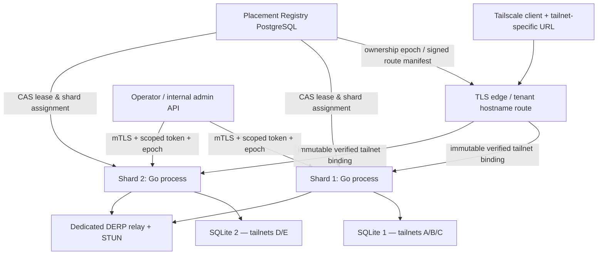
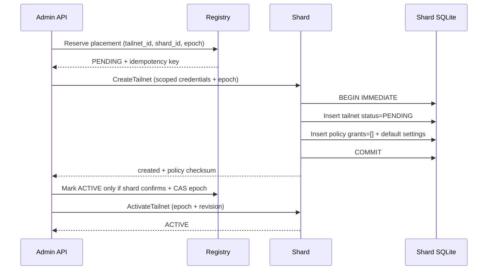

# KẾ HOẠCH TRIỂN KHAI — HEADSCALE NATIVE MULTI-TAILNET & SHARDING

**Phiên bản:** 1.1 (22/11/2026) · **Ngôn ngữ:** Tiếng Việt · **Đối tượng:** AI coding agent + Go reviewer + security reviewer + lab operator.

> Bản 1.1 ghi lại các quyết định của chủ dự án ngày 2026-11-22: baseline v0.1, fresh schema, NodeID/UserID toàn cục, runtime theo tailnet, policy rỗng = DENY, shard classes và tenant migration trong MVP. Lý do và phương án thay thế nằm trong [`design/adr/`](design/adr/). Mọi mục dưới đây vẫn là `Planned` cho tới khi có code và bằng chứng.

## 0. Mục tiêu, giả định và tiêu chí thành công

### Phạm vi phải hoàn thành

1. **Hard fork** từ snapshot nhánh `main` của upstream Headscale (đang phát triển 0.30, migration upstream cuối `202611171200-node-key-expiry-disabled`). Không tồn tại tag `v0.29.7` trong checkout; dự án đánh version từ **v0.1**. Giữ provenance BSD-3-Clause. Bản vá bảo mật upstream được **cherry-pick thủ công** và ghi nhật ký (xem `evidence/source-inventory-P00.md` §1).
2. Một server process quản lý **từ hai tailnet trở lên**. Mỗi tailnet có registry, identity, machine/node key, policy, routes, DNS, IP allocation, netmap và event stream độc lập, chạy trên **runtime riêng** (NodeStore, PolicyManager, Batcher, IPAM, authCache, cấu hình DERP/DNS, Noise key). Không chỉ tạo nhiều Headscale `User`.
3. Client Tailscale thật đăng ký, đổi profile và duy trì kết nối cho các tailnet độc lập; netmap **không chứa** peer hoặc private policy của tailnet khác, kể cả khi thiết bị/machine key/IP/hostname trùng nhau.
4. Nhiều server process thành **shard**; tailnet có một owner tại một thời điểm (`shard_id`, `epoch`). Tạo mới và route tailnet đúng shard; chống split brain.
5. **Mục tiêu dung lượng: multi-tenant.** Hai lớp shard:
   - *shared*: nhiều tenant, mỗi tenant có hard quota **5.000 thiết bị**, cảnh báo ở 80% (4.000).
   - *dedicated*: một tenant, 5.000–10.000 thiết bị.

   Tailnet lớn nhất dự kiến 1k–10k thiết bị, nên **một process phải chịu được 10k thiết bị**. Đây là mục tiêu, chưa phải năng lực đã đo: P00b đo baseline single-process ở 1k/5k/10k trước khi làm sharding.
6. **Tenant migration trong MVP (P12b):** khi tenant vượt ngưỡng, chuyển tenant sang shard khác bằng một cơ chế làm tăng dần. MVP gồm bước (1) fenced move (cold) và (2) rolling drain. Bước (3) pre-copy và (4) read-replica trong lúc drain chỉ làm sau khi có số đo. Chi tiết: [ADR 0003](design/adr/0003-shard-classes-and-tenant-migration.md).
7. Test E2E chạy bằng lab VM/container tạo từ **Proxmox VE**, có cấu hình lại bằng code (IaC), traffic P2P và DERP fallback, negative security tests, chaos testing và benchmark.
8. Mọi tính năng admin/observability/relay có bảo vệ đa tenant. Một process treo/crash không bị quảng bá là hard isolation.

### Không làm trong phạm vi này

- SaaS Portal, billing, multi-org UI, SCIM, production rollout; không tích hợp `network-access-mesh`.
- **Không nâng cấp từ database Headscale.** v0.1 dùng fresh schema; DB Headscale cũ bị từ chối khi khởi động.
- Live migration **zero-staleness** (client không thấy netmap cũ trong lúc chuyển) không thuộc MVP; giữ ở P16. Pre-copy và read-replica (bước 3–4) chỉ bắt đầu sau khi P12b có số đo.
- Phân tán **một tailnet** qua nhiều shard không phải mục tiêu; đơn vị placement là nguyên tailnet.
- Không cam kết “thiết bị không giới hạn” hoặc tuyến tính theo số shard khi chưa benchmark. Các con số 5.000/10.000 ở trên là quota và mục tiêu thiết kế, không phải capacity claim.
- Shard DB không hỗ trợ PostgreSQL; PostgreSQL chỉ dùng cho placement registry.

### Definition of Done mức dự án

- `N1`: 2 tailnet/1 process; các test xuyên tenant S01–S18 pass với Tailscale client thật.
- `N2`: 2 shard/2 process; 3+ tailnet được tạo/định tuyến đúng, không có ghi nhận owner kép; một tailnet được chuyển shard bằng fenced move + rolling drain (P12b) mà không đổi NodeID/StableNodeID và không có owner kép.
- `N3`: backup/restore, restart/reconnect, upgrade canary, dashboard giám sát và các failure-mode tests pass.
- `N4`: load test ở các tổ hợp nhiều tailnet nhỏ / một tailnet lớn (tới 10k thiết bị, so với baseline P00b) / reconnect storm; report p50/p95/p99, RAM, CPU và DB writes; capacity limits được **đo** chứ không đoán.

## 1. Quyết định kỹ thuật ban đầu (không nhầm với điều đã chứng minh)

| Chủ đề | Thiết kế khởi đầu | Cổng kiểm chứng |
|---|---|---|
| Baseline | Snapshot upstream `main` 0.30-dev (squash `2558340`, migration cuối `202611171200`), hard fork version **v0.1**. Không có tag `v0.29.7`. Cherry-pick thủ công bản vá bảo mật upstream | Commit hash, `PROVENANCE.md`, nhật ký cherry-pick, `go test ./...` trên Linux (`mc-ci`) |
| Source | Repo hiện tại; một module Go cho core; tách binary bằng `cmd/` | Baseline build/test trước khi đổi module/import path |
| Multi-tailnet | `TailnetID` là boundary bảo mật; `UserID` chỉ scoped bên trong tailnet | Test lộ node/policy/API/DNS/routes |
| Runtime theo tailnet | Mỗi tailnet có NodeStore, PolicyManager, Batcher, IPAM, authCache, cấu hình DERP/DNS và Noise key riêng. Dùng chung: DB handle (repo đã scoped), listeners, lease client. Chi phí peer map lý thuyết Σnᵢ² thay vì (Σn)²; isolation có sẵn do cấu trúc ([ADR 0001](design/adr/0001-per-tailnet-runtime.md)) | Không còn state toàn process keyed theo node/IP/key; benchmark P00b + L1–L4 |
| ID toàn cục | NodeID và UserID **duy nhất toàn cục** giữa các shard, vì StableNodeID = NodeID (`hscontrol/types/node.go:92`) và relocation không được đánh số lại ([ADR 0002](design/adr/0002-v0.1-fresh-schema-and-global-ids.md)) | Allocator hai shard không trùng; move giữ nguyên StableNodeID; ID không tái sử dụng |
| Storage | **SQLite riêng cho mỗi shard** (chỉ SQLite). Fresh schema v0.1: `tailnet_id NOT NULL`, composite FK, unique `(tailnet_id, …)` từ đầu; `versioncheck` từ chối DB Headscale cũ. Có `key_inventory` và revision/event log theo tailnet | Fresh DB + squibble digest, FK/unique negative tests, test từ chối DB upstream, concurrent write |
| Registry | PostgreSQL độc lập cho placement và ownership epochs | CAS và fencing tests |
| Default policy | Khi tạo tailnet, ghi **cùng transaction** policy `{"grants":[]}` và `PENDING`; chỉ active khi cấu hình hợp lệ. Với tailnet tenant, policy nil/rỗng/`{}` = **DENY** (khác upstream: `policy.go:341`, `filter.go:135`, `types.go:3427` coi là allow-all). Không dựa vào round-trip JSON vì `omitempty` trên `ACLs`/`Grants` (`types.go:2140-2141`) làm mất `[]` | Concurrency test: không có cửa sổ allow-all; round-trip test policy rỗng vẫn deny |
| Endpoint | Hostname riêng ổn định cho mỗi tailnet (`<id>.mesh.test`), edge điều hướng host → shard | Client thật + Host/SNI spoof tests |
| Noise identity | Ưu tiên **key riêng theo tailnet** và ánh xạ `/key` cùng Noise session; coi là **POC bắt buộc**, không coi là đã hỗ trợ | Hai host cùng một process, key khác nhau, client thực login/reconnect |
| OIDC | N1 dùng signed tenant-bound enrollment token + web approval tối thiểu; chưa bật OIDC upstream global trên shared shard | Replay, cross-tenant approve & expiry tests |
| DERP | N1 ưu tiên DERP external có verify scoped; embedded DERP **disabled** cho tới khi audit xong | Relay data/security/DoS test và verify fail-closed |
| Sharding | Một tailnet chỉ có một active shard. Hai lớp: *shared* (nhiều tenant, hard quota 5.000 thiết bị/tenant, cảnh báo 80%) và *dedicated* (một tenant, 5k–10k) ([ADR 0003](design/adr/0003-shard-classes-and-tenant-migration.md)) | Epoch+lease ownership, stale request tests, quota enforcement test, số đo P00b |
| Migration | Một cơ chế làm tăng dần: (1) fenced move cold, (2) rolling drain — **MVP, P12b**; (3) pre-copy, (4) read-replica trong lúc drain — sau khi đo. State trong bộ nhớ (authCache, sshCheckAuth, pings, ephemeral GC timers) bị từ chối hoặc reset khi move. Phương án thay thế: chuyển các tenant hàng xóm. Zero-staleness = P16 | Không owner kép, NodeID giữ nguyên, kiểm `key_inventory`, rollback, client thật reconnect |

**Chú ý về Noise:** phải chứng minh key theo tailnet tương thích với Tailscale client. Nếu POC thất bại, không tự ý chuyển sang “1 Noise key chung cho shard” và tuyên bố isolation. Agent lập ADR phương án thay thế, bằng chứng protocol-level và chờ duyệt bảo mật.

## 2. Cấu trúc repository mục tiêu

```text
mesh-controlplane/
├── cmd/
│   ├── mesh-controlplane/      # binary điều khiển VPN; đổi tên sau baseline
│   ├── mesh-placement/         # registry/placement coordinator
│   ├── gen-openapi/            # upstream: sinh OpenAPI từ Huma
│   └── hi/                     # giữ/upstream adapt integration harness
├── hscontrol/                 # bắt đầu từ upstream, refactor từng lớp
│   ├── state/                 # runtime theo tailnet, NodeStore, sự kiện
│   ├── db/                    # fresh schema v0.1, typed scoped queries
│   ├── mapper/                # MapResponse + delta + stream scoped
│   ├── policy/v2/             # engine policy theo tailnet
│   ├── scope/                 # upstream: OAuth scope của API v2 (KHÔNG phải tailnet scope)
│   ├── servertest/            # upstream: TestScale, test server in-memory
│   ├── dns/  routes/  derp/   # cấm global tenant-confused settings
│   └── ...
├── internal/
│   ├── tailnet/               # TailnetID, VerifiedScope, context, authorization
│   ├── placement/             # model, CAS, lease, routing policy
│   └── controlapi/            # tenant-scoped admin API
├── integration/               # tiếp tục harness Tailscale thật
├── infra/lab/                # OpenTofu, cloud-init, Ansible, scripts
├── design/adr/               # ADR của fork
├── tickets/                  # ticket Pxx
├── evidence/                 # source-inventory-Pxx.md và bằng chứng PR
├── docs/                     # upstream mkdocs (giữ nguyên)
├── gen/client/v1|v2/         # client sinh bởi oapi-codegen; không sửa tay
├── go.mod  go.sum
└── AGENTS.md
```

**Lưu ý tên package:** `hscontrol/scope` đã tồn tại và là OAuth scope của API v2 (`scope.Scope`), không liên quan tới tailnet. Kiểu tailnet (`TailnetID`, `VerifiedScope`, helper context) đặt ở `internal/tailnet`, không đặt tên package là `scope` để tránh nhầm khi review.

**Codegen:** repo không có `proto/`. API dùng Huma + OpenAPI: `make openapi` (`cmd/gen-openapi`) xuất spec, `make generate` sinh code và gọi `make client` để tạo `gen/client/v1/client.gen.go`, `gen/client/v2/client.gen.go` (oapi-codegen được pin trong `Makefile`).

**Tài liệu dự án:** các file `03-…06-*.md`, `PLAN.md`, `HANDOFF_PROMPT.md` nằm ở root. `docs/` là tài liệu mkdocs của upstream.

Không bắt đầu bằng thao tác `sed` toàn bộ import của Headscale: giữ nguyên baseline build, sau đó thay module/import theo một PR riêng có full test. `go.mod` của snapshot ghi `go 1.27.4` (không có dòng `toolchain`); phải dùng Go theo checkout, **không dùng Go 1.23 hệ thống**.

## 3. Sơ đồ hoạt động và trust boundary



Bên trong mỗi shard, listener nhận request rồi chọn **runtime của đúng tailnet** theo binding đã xác thực; các runtime không chia sẻ NodeStore, PolicyManager, Batcher hay cache.

### Quy tắc định tuyến và xác thực

1. TLS edge nhận domain `<tailnet>.mesh.test`, xác thực đúng SNI/Host; không chấp nhận header giả do client gửi như `X-Tailnet-ID`.
2. Edge xây `VerifiedRouteContext(tailnet_id, shard_id, epoch)` chỉ bằng mapping do placement registry quản lý, chuyển qua kênh tin cậy; shard **phải kiểm tra lại** quyền và epoch.
3. `/key` và Noise upgrade/request sử dụng đúng `VerifiedRouteContext`. Map/auth/poll trên **cùng một session** không được thay đổi tailnet. `tailnet_id` từ payload client chỉ là tín hiệu đối chiếu, không phải nguồn đáng tin.
4. Khi đăng ký qua browser, trạng thái pending phải gắn tailnet, requester, hashed machine/node identity, nonce, time-bound claim và single-use approval.
5. API admin yêu cầu mTLS service identity + credential scoped tailnet + operation + epoch (và idempotency key cho mutate); quyền super-admin quản lý shard tách hoàn toàn khỏi token tenant.

## 4. Data model / migration: fresh schema v0.1

v0.1 **không** thêm migration vào cuối chuỗi upstream. Fork mở **chuỗi migration mới** với schema có `tailnet_id` ngay từ đầu; không có đường nâng cấp từ DB Headscale. Chi tiết và phương án thay thế: [ADR 0002](design/adr/0002-v0.1-fresh-schema-and-global-ids.md).

**Bảng dự kiến:** `tailnets(id, slug, status, policy_revision, config_revision, created_at, deleted_at)`, `tailnet_settings`, `tailnet_policies`, `tailnet_events` (revision/event log), `pending_registrations`, `key_inventory`, `audit_events`, và `users`, `nodes`, `credentials`, routes, SSH-related authority với `tailnet_id NOT NULL`. Tên thật chốt trong P03 sau khi audit `hscontrol/db/schema.sql` của snapshot.

**Invariants bắt buộc:**

- `UNIQUE(tailnet_id, machine_key)` cho machine identity theo cách mã hóa lưu thực tế; thêm ràng buộc tương ứng cho node keys và preauth credentials. Không áp unique `machine_key` toàn shard vì cho phép profile A/B cùng thiết bị. Các unique index toàn cục của upstream (`users.name`, `provider_identifier` ở `schema.sql:37-39`; `credentials(kind, identifier)` ở `schema.sql:69`) phải được xem lại: unique theo `(tailnet_id, …)` hoặc ghi rõ lý do giữ toàn cục.
- Mọi FK tenant-sensitive có composite FK `(tailnet_id, entity_id)` hoặc constraint tương đương. Không thể dùng `user_id` thuộc B từ Node A.
- **NodeID và UserID duy nhất toàn cục** giữa các shard và không tái sử dụng sau khi xóa. Không dùng `AUTOINCREMENT` cục bộ của từng shard làm nguồn ID duy nhất. Cơ chế cấp phát đề xuất ở ADR 0002.
- `CreateTailnet` ghi chính sách `{"grants":[]}`, settings và status `PENDING` **trong cùng transaction**. `Activate` chỉ được gọi sau khi verifier/engine policy nhận default-deny. Với tailnet tenant, policy nil/rỗng/`{}` đọc từ DB cũng phải ra **DENY**.
- `key_inventory` theo tailnet (machine key, node key, Noise identity public key, checksum) và revision/event log theo tailnet là điều kiện cho P12b: shard đích phải kiểm được dữ liệu đã nhận đủ và đúng revision.
- Runtime theo tailnet: NodeStore, event channel, mapper subscriber, node list, DNS, IPAM, route lookup và policy evaluator thuộc runtime của tailnet. Cấm cache toàn process keyed chỉ bởi name/IP/machine-key.
- IP trùng nhau giữa các tailnet có thể hợp lệ; test overlap địa chỉ VPN và subnet route.
- SQLite một writer process; bật WAL/busy timeout theo cấu hình được xác minh, không dùng cùng file trên NFS hoặc hai process. Shard DB **chỉ SQLite**; cấu hình PostgreSQL cho shard bị từ chối.
- `versioncheck` từ chối DB Headscale cũ (có migration upstream, không có marker v0.1) với lỗi rõ ràng; không cố nâng cấp.
- Migration của fork: sau khi đã commit thì không sửa, không reorder, chỉ thêm vào cuối chuỗi v0.1; không `AutoMigrate` trong migration, không disable FK, chạy trong transaction (`hscontrol/db/AGENTS.md`). Schema test: fresh DB, squibble digest khớp `schema.sql`, test từ chối DB upstream, và nâng cấp giữa các migration của fork khi đã có.

**Ví dụ SQL định hướng, KHÔNG phải migration có thể áp dụng trực tiếp:**

```sql
CREATE TABLE tailnets (
  id TEXT PRIMARY KEY,
  slug TEXT NOT NULL UNIQUE,
  status TEXT NOT NULL CHECK(status IN ('PENDING','ACTIVE','SUSPENDED','MOVING','DELETING')),
  policy_revision INTEGER NOT NULL DEFAULT 1,
  created_at TEXT NOT NULL
);
CREATE TABLE tailnet_policies (
  tailnet_id TEXT PRIMARY KEY REFERENCES tailnets(id),
  policy_json TEXT NOT NULL DEFAULT '{"grants":[]}',
  revision INTEGER NOT NULL DEFAULT 1
);
CREATE TABLE users (
  id INTEGER PRIMARY KEY,            -- cấp từ allocator toàn cục, không AUTOINCREMENT
  tailnet_id TEXT NOT NULL REFERENCES tailnets(id),
  name TEXT,
  UNIQUE (tailnet_id, id)
);
CREATE TABLE nodes (
  id INTEGER PRIMARY KEY,            -- NodeID toàn cục; StableNodeID = id
  tailnet_id TEXT NOT NULL REFERENCES tailnets(id),
  user_id INTEGER,
  machine_key TEXT NOT NULL,
  FOREIGN KEY (tailnet_id, user_id) REFERENCES users(tailnet_id, id)
);
CREATE UNIQUE INDEX idx_nodes_tailnet_machine_key ON nodes(tailnet_id, machine_key);
```

## 5. Luồng `CreateTailnet` fail-closed



Nếu bất kỳ bước nào lỗi: giữ ở `PENDING`, không phát enrollment key/MapResponse với rule allow-all, retry idempotent; reconciler thu hồi việc chưa hoàn thành. Registry và SQLite **không có distributed transaction**; phải dùng saga/reconcile, không coi hai commit là nguyên tử toàn hệ thống.

## 6. Trình tự triển khai qua PR (critical path)

| ID | Công việc | Phụ thuộc | Bằng chứng merge |
|---|---|---|---|
| P00 | Rebaseline snapshot v0.1, provenance, sửa lệch docs, CI baseline | — | commit hash, `PROVENANCE.md`, `make build`, `go test ./...` trên Linux |
| P00b | Benchmark single-process 1k/5k/10k node (RSS, thời gian tính peer, map p95, reconnect storm) | P00 | report + artifacts; `TestScale` với `HEADSCALE_STRESS_NODES`, `batcher_scale_bench_test.go` |
| P01 | Repo rename / module boundaries / typed TailnetID (`internal/tailnet`) | P00 | build+tests pass, import graph và license |
| P02 | POC Noise key/hostname/client profile, reject host spoof | P01 | 2 host→1 process client thật; protocol traces |
| P03 | Fresh schema v0.1 (`tailnet_id NOT NULL`, composite FK, unique `(tailnet_id, …)`, ID toàn cục, `key_inventory`, revision log), `versioncheck` từ chối DB Headscale, `CreateTailnet` default-deny atomic | P02 | fresh DB/FK/unique negative tests, concurrency tests |
| P04 | Auth, enrollment, session/approval scoped | P03 | replay/cross-tailnet tests |
| P05 | Runtime theo tailnet: State/NodeStore/DB scoped; IP allocator | P04 | peers/IP/machine-key collision tests |
| P06 | Policy/ACL, DNS, routes, exit-node isolation | P05 | policy wildcard, DNS/route leak tests |
| P07 | Mapper, event, MapResponse deltas scoped | P06 | E2E no cross-peer keys/netmap & reconnect |
| P08 | API/admin/metrics/debug/queue limits/DERP | P07 | authZ, DoS, endpoint audit |
| P09 | **Gate N1**: real-client 2+ tailnet/1 process | P08 + lab giai đoạn 2 | toàn bộ S01–S18 + client compatibility |
| P10 | Placement DB + epoch CAS + shard discovery + shard class | P09 + P00b | owner uniqueness tests |
| P11 | Edge route manifest, long-lived sessions, mTLS | P10 | spoof/invalidation/stale-epoch tests |
| P12 | Second shard, fresh placement + reconcile | P11 | 3 tailnet/2 shards, restart tests |
| P12b | Tenant move: fenced move (cold) + rolling drain | P12 | move với client thật, không owner kép, NodeID giữ nguyên, rollback |
| P13 | Backup/restore, upgrade/canary/shard operations | P12b | recover + checksum + config compatibility |
| P14 | Performance, reconnect storm, quotas theo shard class | P13 | benchmark report & agreed SLO |
| P15 | **Gate N2–N4**: sharding E2E, failure injection | P14 | signed audit record + all gates pass |
| P16 (sau MVP) | Live relocation zero-staleness (pre-copy, read-replica trong lúc drain) | P15 + số đo P12b + ADR | không netmap cũ, no dual owner, rollback |

**Lab giai đoạn 2** (shards, edge, placement, DERP, clients, mạng underlay tách biệt) phải xong **trước P09**. Giai đoạn 1 hiện có `mc-ci` (VMID 7701). Xem `04-proxmox-lab.md`.

Mỗi PR phải kèm: (a) scope file/symbol thực tế, (b) unit/integration/negative tests, (c) migration notes, (d) evidence command/exit code, (e) rollback-safe behavior, (f) điều kiện dừng. Tickets chi tiết ở [`tickets/`](tickets/) (hiện có P00, P00b, P01, P02, P03, P12b).

## 7. Gates: agent không được nhảy cóc

**N0 — Upstream Verified:** commit snapshot, `PROVENANCE.md` và nhật ký cherry-pick bản vá bảo mật verified; baseline build, unit tests, integration smoke pass trên Linux; P00b có số đo baseline; test lab không chứa production secrets.

**N1 — Tailnet Isolation:** 2 tailnet chung process, runtime riêng; ngăn cross-tailnet registration, map, policy, DNS, routes, API và metrics; grants=[] atomic; policy nil/rỗng của tailnet tenant = deny; machine key trùng khác tailnet hợp lệ; Noise POC được chấp nhận bởi reviewer.

**N2 — Placement & Fencing:** 2 shard, unique owner/epoch, request stale bị chặn; tenant không bị split; edge fail-closed khi binding không rõ; reconnect sau shard restart hoạt động; fenced move + rolling drain (P12b) không có owner kép và giữ nguyên NodeID.

**N3 — Operational:** backup/restore mới, upgrade shard có canary tại **cấp shard** chứ không phải tenant, phù hợp schema; DERP/STUN verified; queue limit/rate limit và monitoring.

**N4 — Capacity:** SLO do người phụ trách xác nhận dựa trên benchmark; không gọi 'unlimited'. Kiểm thử nhiều tailnet nhỏ, một tailnet lớn (tới 10k thiết bị trên dedicated shard), burst registration, reconnect storm, policy changes, relay saturation, quota 5.000/tenant trên shared shard.

**N5 — Release Review (ngoài MVP):** independent security review, CVE/dependency audit, license, DR drill, vận hành thực tế; các block risk chưa xử lý -> NO-GO.

## 8. Test Plan tối thiểu tại mỗi gate

- Integration harness upstream: `go run ./cmd/hi doctor`, `go run ./cmd/hi run "TestPingAllByIP"` (sau khi đọc `cmd/hi/README.md`). Các bài test multi-tailnet mới phải được thêm vào harness, không đánh đồng scenario nhiều user với nhiều tailnet. Ưu tiên `hscontrol/servertest` khi không cần Docker (`integration/AGENTS.md`).
- Race: `CGO_ENABLED=1 go test -race ./...` trong toolchain hỗ trợ.
- Snapshot/model fuzz: cùng machine key, cùng node name, cùng IP, cùng route, cùng tag/ACL wildcard, cùng OIDC subject; kiểm thử stale cache và cập nhật đồng thời.
- Auth/Noise: key endpoint đúng tenant, Host/SNI mismatch, replay token, thử thay tenant binding giữa hai frame map của một stream.
- Service auth: mTLS client identity sai, token tenant A gọi tenant B, expired/stale epoch, restore backup đảo epoch.
- Fencing: hai shard cùng nhận ownership: **chỉ một** được phép thực hiện mutation/enroll/serve map cho một tailnet; trong lúc move, shard nguồn đã bị fence không phát MapResponse mới.
- DERP: verify fail-closed, node unknown/revoked, relay saturation; STUN là dịch vụ khám phá NAT, không làm phép ACL.
- Security observability: không cho Internet đọc `/debug/*`, metrics không trả public node IDs/IPs.

## 9. Hạ tầng lab Proxmox (tự tạo, không tự phá)

**Cấu hình tham khảo, phải đối chiếu tài nguyên host thực** (tên VM theo `04-proxmox-lab.md` §4):

| VM | CPU / RAM | Nhiệm vụ |
|---|---|---|
| `mc-ci` | 8 vCPU / 16–32 GB | Git/Go build, container test, OpenTofu runner. **Đã tạo** (VMID 7701, 192.168.1.240) |
| `mc-placement` | 2 vCPU / 4 GB | Placement API + PostgreSQL (lab) |
| `mc-edge` | 2 vCPU / 2 GB | Caddy/Nginx, TLS, route manifests |
| `mc-shard-01` | 4 vCPU / 8 GB | Multi-tailnet process + SQLite DB 01 |
| `mc-shard-02` | 4 vCPU / 8 GB | Multi-tailnet process + SQLite DB 02 |
| `mc-relay` | 2 vCPU / 2 GB | DERP + STUN + scoped verify |
| `mc-client-a1/a2` | 1 vCPU / 1–2 GB mỗi VM | Tailscale clients thuộc A |
| `mc-client-b1/b2` | 1 vCPU / 1–2 GB mỗi VM | Tailscale clients thuộc B |

**Giai đoạn:** giai đoạn 1 = `mc-ci` (đã có). Giai đoạn 2 = shards, edge, placement, DERP, clients và mạng underlay tách biệt; phải xong trước P09. P00b chạy trên `mc-ci`; nếu 10k node vượt tài nguyên `mc-ci`, ghi lại là kết quả và đề xuất VM benchmark riêng trong pool lab.

**Tối ưu lab nhỏ:** giảm VM cho client bằng Docker network namespaces trên `mc-ci` trong giai đoạn unit/POC, nhưng vẫn giữ ít nhất các VM khác host/network để test E2E và fault injection. Tổng bảng trên là **ước tính cấu hình dành riêng**, không phải giá trị bắt buộc hoặc capacity benchmark.

**Mạng đề xuất:** `10.77.10.0/24` (management), `10.77.20.0/24` (client A underlay), `10.77.30.0/24` (client B underlay), `10.77.40.0/24` (services); tách qua bridge/VLAN/ACL/firewall. **Không** cho underlay A↔B reachability trực tiếp khi test điều kiện “VPN isolation”. Router/DERP được mở đúng cổng thử nghiệm (HTTPS/TCP 443, STUN UDP 3478 theo server). TLS dùng CA lab, đảm bảo client tin certificate hợp lệ, không `-k` trong E2E.

**IaC:** OpenTofu/Terraform + provider `bpg/proxmox`; tạo Ubuntu cloud images, cloud-init, inventory Ansible, SSH keys test, mạng/firewall riêng, DNS lab và manifests; provision bằng `root@pam` (chủ lab cho phép ngày 2026-11-22), nhưng chỉ thao tác trong pool lab và dải VMID `7700–7799`. Quy trình chuẩn là `fmt → validate → plan -out → apply`. Agent tự apply khi plan chỉ create/update trong phạm vi lab; các trường hợp khác cần human approval. `destroy` luôn cần phê duyệt độc lập. Xem `04-proxmox-lab.md` §5–6.

## 10. Tổ chức agent và control of change

- `Architect agent`: chỉ chỉnh ADR, test contracts và ticket scope; không được approve chính công việc của mình.
- `Coding agent`: một PR tại một thời điểm, phải đọc source checkout; chạy test phù hợp, kèm chứng cứ và diff.
- `Infra agent`: `tofu plan` và sinh manifest. Được dùng `root@pam` và tự `apply` khi plan chỉ create/update trong pool + dải VMID lab. `destroy`, `replace` và mọi thay đổi ngoài phạm vi đó cần người vận hành duyệt.
- `Reviewer`: xác minh security invariants; đặc biệt `P02` (Noise), `P03` (fresh schema + default-deny), `P05–P07` (map), `P12b` (fencing khi move). Test pass nhưng invariants sai => reject.

**Quy tắc đối với code chưa xác minh:** Source map mô tả nơi xem/sửa ban đầu, **không** cam kết các signature không được kiểm tra trên checkout. Mỗi ticket buộc agent tạo/cập nhật `evidence/source-inventory-Pxx.md` trước khi sửa (một tên file duy nhất cho inventory).

## 11. Ước lượng tương đối và các rủi ro đường găng

Đội giả định 1–2 kỹ sư Go chuyên sâu networking, agent hỗ trợ và có Proxmox lab sẵn:

- N0 (toolchain + lab + baseline + P00b): 1–2 tuần.
- N1 (multi-tailnet auth/state/policy/map E2E): 6–12 tuần **hoặc hơn** nếu Noise POC đòi sửa giao thức.
- N2 (registry, routing, 2 shard, P12b): thêm 4–8 tuần.
- N3–N4 (ops + security + perf): thêm 4–8 tuần.

Các mốc là **ước lượng lập kế hoạch**; không phải cam kết. Đường găng: Noise binding → fresh schema + runtime theo tailnet → scoped mapper → real client E2E → fencing → tenant move → failure recovery. Có thể chạy Proxmox lab setup song song với N0 nhưng không phát triển sharding trước khi N1 qua gate và P00b có số đo.

## 12. Deliverables cuối cùng agent phải bàn giao

- Source, migration DDL, OpenAPI (Huma) + Go client `gen/client/v1|v2`, Docker images và reproducible build (`git SHA`, dependency lock, SBOM).
- Proxmox IaC + Ansible + README thao tác; file tfvars.example, không chứa secrets; export VM inventory.
- 2 tailnet/1 process và 3 tailnet/2 shard E2E scripts; logs/map snapshots đã redacted; traffic evidence.
- `release-gates.md` có test IDs và link tới CI artifacts; security signoff, known limitations.
- Runbook restart shard, drain connections, tenant move (fenced + rolling drain), restore SQLite, reconcile registry, revoke tenant và rotate keys.

**Chỉ khi từng gate có bằng chứng mới nâng trạng thái từ “plan/POC” sang “implemented/verified”.**
