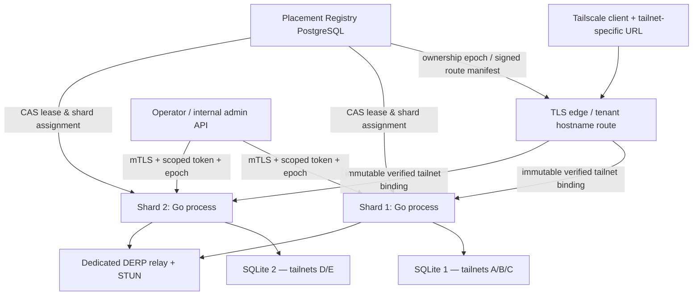
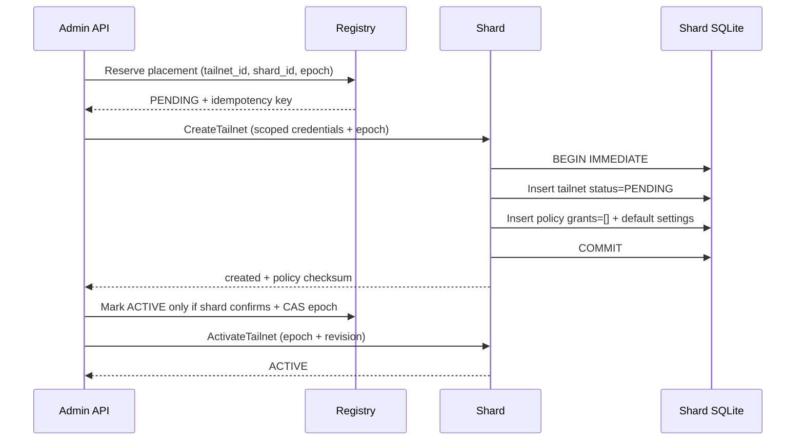

# KẾ HOẠCH TRIỂN KHAI — HEADSCALE NATIVE MULTI-TAILNET & SHARDING

**Phiên bản:** 1.0 (22/11/2026) · **Ngôn ngữ:** Tiếng Việt · **Đối tượng:** AI coding agent + Go reviewer + security reviewer + lab operator.

## 0. Mục tiêu, giả định và tiêu chí thành công

### Phạm vi phải hoàn thành

1. Tạo **mã nguồn mới trực tiếp từ upstream Headscale v0.29.7**; giữ provenance BSD-3-Clause, lịch sử phiên bản và những bản vá bảo mật phát hành.
2. Một server process quản lý **từ hai tailnet trở lên**, mỗi tailnet có registry, identity, machine/node key, policy, routes, DNS, IP allocation, netmap và event stream độc lập. Không chỉ tạo nhiều Headscale `User`.
3. Client Tailscale thật đăng ký, đổi profile và duy trì kết nối cho các tailnet độc lập; netmap **không chứa** peer hoặc private policy của tailnet khác, kể cả khi thiết bị/machine key/IP/hostname trùng nhau.
4. Nhiều server process thành **shard**; tailnet có một owner tại một thời điểm (`shard_id`, `epoch`). Tạo mới và route tailnet đúng shard; chống split brain.
5. Test E2E chạy bằng lab VM/container tạo từ **Proxmox VE**, có cấu hình lại bằng code (IaC), traffic P2P và DERP fallback, negative security tests, chaos testing và benchmark.
6. Mọi tính năng admin/observability/relay có bảo vệ đa tenant. Một process treo/crash không bị quảng bá là hard isolation.

### Không làm trong phạm vi này

- SaaS Portal, billing, multi-org UI, SCIM, production rollout; không tích hợp `network-access-mesh`.
- Live tenant migration không gián đoạn **không phải điều kiện MVP sharding**; phải có POC danh tính và lifecycle trước khi làm.
- Phân tán **một tailnet** qua nhiều shard không phải mục tiêu; đơn vị placement là nguyên tailnet.
- Không cam kết “thiết bị không giới hạn” hoặc tuyến tính theo số shard khi chưa benchmark.

### Definition of Done mức dự án

- `N1`: 2 tailnet/1 process; các test xuyên tenant S01–S18 pass với Tailscale client thật.
- `N2`: 2 shard/2 process; 3+ tailnet được tạo/định tuyến đúng, không có ghi nhận owner kép.
- `N3`: backup/restore, restart/reconnect, upgrade canary, dashboard giám sát và các failure-mode tests pass.
- `N4`: load test ở các tổ hợp nhiều tailnet nhỏ / một tailnet lớn / reconnect storm; report p50/p95/p99, RAM, CPU và DB writes; capacity limits được **đo** chứ không đoán.

## 1. Quyết định kỹ thuật ban đầu (không nhầm với điều đã chứng minh)

| Chủ đề | Thiết kế khởi đầu | Cổng kiểm chứng |
|---|---|---|
| Baseline | Headscale `v0.29.7`; không bám `main` khi đang refactor | Tag/commit SHA, checksum, `go test ./...` |
| Source | Repo mới tạo từ source upstream; một module Go cho core; tách binary bằng `cmd/` | Baseline build/test trước khi đổi module/import path |
| Multi-tailnet | `TailnetID` là boundary bảo mật; `UserID` chỉ scoped bên trong tailnet | Test lộ node/policy/API/DNS/routes |
| Storage | **SQLite database riêng cho mỗi shard**; trong shard có bảng `tailnets` và tenant-scoped records | Test transaction, tenant filtering, concurrent write |
| Registry | PostgreSQL độc lập cho placement và ownership epochs | CAS và fencing tests |
| Default policy | Khi tạo tailnet, ghi **cùng transaction** với policy empty `{"grants":[]}` và `SUSPENDED/PENDING`; chỉ active khi cấu hình hợp lệ | Concurrency test: không có cửa sổ allow-all |
| Endpoint | Hostname riêng ổn định cho mỗi tailnet (`<id>.mesh.test`), edge điều hướng host → shard | Client thật + Host/SNI spoof tests |
| Noise identity | Ưu tiên **key riêng theo tailnet** và ánh xạ `/key` cùng Noise session; coi là **POC bắt buộc**, không coi là đã hỗ trợ | Hai host cùng một process, key khác nhau, client thực login/reconnect |
| OIDC | N1 dùng signed tenant-bound enrollment token + web approval tối thiểu; chưa bật OIDC upstream global trên shared shard | Replay, cross-tenant approve & expiry tests |
| DERP | N1 ưu tiên DERP external có verify scoped; embedded DERP **disabled** cho tới khi audit xong | Relay data/security/DoS test và verify fail-closed |
| Sharding | Một tailnet chỉ có một active shard, không chia node của tailnet cho hai shard | Epoch+lease ownership và stale request tests |
| Migration | Bắt đầu với placement bất biến; live relocation vào mốc sau | Identity continuity + rolling connection cutover POC |

**Chú ý về Noise:** phải chứng minh key theo tailnet tương thích với Tailscale client. Nếu POC thất bại, không tự ý chuyển sang “1 Noise key chung cho shard” và tuyên bố isolation. Agent lập ADR phương án thay thế, bằng chứng protocol-level và chờ duyệt bảo mật.

## 2. Cấu trúc repository mục tiêu

```text
mesh-controlplane/
├── cmd/
│   ├── mesh-controlplane/      # binary điều khiển VPN; đổi tên sau baseline
│   ├── mesh-placement/         # registry/placement coordinator
│   └── hi/                     # giữ/upstream adapt integration harness
├── hscontrol/                 # bắt đầu từ upstream, refactor từng lớp
│   ├── state/                 # TailnetState, NodeStore, sự kiện
│   ├── db/                    # schema/migrations, typed scoped queries
│   ├── mapper/                # MapResponse + delta + stream scoped
│   ├── policy/v2/             # engine policy theo tailnet
│   ├── dns/  routes/  derp/   # cấm global tenant-confused settings
│   └── ...
├── internal/
│   ├── tailnet/               # TailnetID, context, authorization
│   ├── placement/             # model, CAS, lease, routing policy
│   └── controlapi/            # tenant-scoped admin API
├── integration/               # tiếp tục harness Tailscale thật
├── infra/lab/                # OpenTofu, cloud-init, Ansible, scripts
├── docs/                     # ADR + API + threat-model + ops
├── proto/  gen/               # theo codegen upstream, không sửa gen thủ công
├── go.mod  go.sum
└── AGENTS.md
```

Không bắt đầu bằng thao tác `sed` toàn bộ import của Headscale: giữ nguyên baseline build, sau đó thay module/import theo một PR riêng có full test. `go.mod` gốc của `v0.29.7` yêu cầu toolchain hiện đại (đối chiếu trên checkout, upstream docs ghi Go 1.27.3); phải dùng Go theo checkout, **không dùng Go 1.23 hệ thống**.

## 3. Sơ đồ hoạt động và trust boundary



### Quy tắc định tuyến và xác thực

1. TLS edge nhận domain `<tailnet>.mesh.test`, xác thực đúng SNI/Host; không chấp nhận header giả do client gửi như `X-Tailnet-ID`.
2. Edge xây `VerifiedRouteContext(tailnet_id, shard_id, epoch)` chỉ bằng mapping do placement registry quản lý, chuyển qua kênh tin cậy; shard **phải kiểm tra lại** quyền và epoch.
3. `/key` và Noise upgrade/request sử dụng đúng `VerifiedRouteContext`. Map/auth/poll trên **cùng một session** không được thay đổi tailnet. `tailnet_id` từ payload client chỉ là tín hiệu đối chiếu, không phải nguồn đáng tin.
4. Khi đăng ký qua browser, trạng thái pending phải gắn tailnet, requester, hashed machine/node identity, nonce, time-bound claim và single-use approval.
5. API admin yêu cầu mTLS service identity + credential scoped tailnet + operation + epoch (và idempotency key cho mutate); quyền super-admin quản lý shard tách hoàn toàn khỏi token tenant.

## 4. Data model / migration: an toàn trong một shard

**Thêm bản ghi:** `tailnets(id, slug, status, policy_revision, config_revision, created_at, deleted_at)`, `tailnet_settings`, `tailnet_policies`, `tailnet_events`, `pending_registrations`, `key_inventory`, `audit_events`; bổ sung `tailnet_id` không-null cho các record liên quan `users`, `nodes`, `routes`, credentials, policy/ACL, SSH-related authority. Tên thật phải chốt sau khi audit schema ở tag đã pin.

**Invariants bắt buộc:**

- `UNIQUE(tailnet_id, machine_key)` cho machine identity tùy mã hóa lưu thực tế; thêm các ràng buộc phù hợp cho node keys và preauth credentials. Không áp unique `machine_key` toàn shard nếu cho phép profile A/B cùng thiết bị.
- Mọi FK tenant-sensitive có composite FK `(tailnet_id, entity_id)` hoặc constraint tương đương. Không thể dùng `user_id` thuộc B từ Node A.
- `CreateTailnet` ghi chính sách `{"grants":[]}`, settings và status `PENDING` **trong cùng transaction**. `Activate` chỉ được gọi sau khi verifier/engine policy nhận default-deny.
- `NodeStore` có snapshot per-tailnet; event channel, mapper subscriber, node list, DNS, IPAM, route lookup và policy evaluator đều được scoped. Cấm cache global keyed chỉ bởi name/IP/machine-key.
- IP trùng nhau giữa các tailnet có thể hợp lệ; test overlap địa chỉ VPN và subnet route. NodeID có thể cần uniqueness toàn shard cho các API/protocol: xác minh trước khi thay đổi ID allocator.
- SQLite một writer process; bật WAL/busy timeout theo cấu hình được xác minh, không dùng cùng file trên NFS hoặc hai process.
- Migrate DB chỉ thêm migration ở cuối, không `AutoMigrate` trong migration, không disable FK; không sửa migration upstream. Schema test tạo fresh DB và nâng cấp từ baseline.

**Ví dụ SQL định hướng, KHÔNG phải migration có thể áp dụng trực tiếp:**

```sql
CREATE TABLE tailnets (
  id TEXT PRIMARY KEY,
  slug TEXT NOT NULL UNIQUE,
  status TEXT NOT NULL CHECK(status IN ('PENDING','ACTIVE','SUSPENDED','DELETING')),
  policy_revision INTEGER NOT NULL DEFAULT 1,
  created_at TEXT NOT NULL
);
CREATE TABLE tailnet_policies (
  tailnet_id TEXT PRIMARY KEY REFERENCES tailnets(id),
  policy_json TEXT NOT NULL DEFAULT '{"grants":[]}',
  revision INTEGER NOT NULL DEFAULT 1
);
-- ALTER TABLE nodes ADD COLUMN tailnet_id ...; (thực thi sau audit FK/unique/index)
-- CREATE UNIQUE INDEX ... ON nodes(tailnet_id, machine_key);
```

## 5. Luồng `CreateTailnet` fail-closed



Nếu bất kỳ bước nào lỗi: giữ ở `PENDING`, không phát enrollment key/MapResponse với rule allow-all, retry idempotent; reconciler thu hồi việc chưa hoàn thành. Registry và SQLite **không có distributed transaction**; phải dùng saga/reconcile, không coi hai commit là nguyên tử toàn hệ thống.

## 6. Trình tự triển khai qua PR (critical path)

| ID | Công việc | Phụ thuộc | Bằng chứng merge |
|---|---|---|---|
| P00 | Bootstrap source `v0.29.7`, provenance, CI baseline | — | SHA/tag, `make build`, `go test ./...` |
| P01 | Repo rename / module boundaries / typed TailnetID | P00 | build+tests pass, import graph và license |
| P02 | POC Noise key/hostname/client profile, reject host spoof | P01 | 2 host→1 process client thật; protocol traces |
| P03 | DB schema & `CreateTailnet` default-deny atomic | P02 | concurrency negative tests |
| P04 | Auth, enrollment, session/approval scoped | P03 | replay/cross-tailnet tests |
| P05 | State/NodeStore/DB scoped; IP allocator | P04 | peers/IP/machine-key collision tests |
| P06 | Policy/ACL, DNS, routes, exit-node isolation | P05 | policy wildcard, DNS/route leak tests |
| P07 | Mapper, event, MapResponse deltas scoped | P06 | E2E no cross-peer keys/netmap & reconnect |
| P08 | API/admin/metrics/debug/queue limits/DERP | P07 | authZ, DoS, endpoint audit |
| P09 | **Gate N1**: real-client 2+ tailnet/1 process | P08 | toàn bộ S01–S18 + client compatibility |
| P10 | Placement DB + epoch CAS + shard discovery | P09 | owner uniqueness tests |
| P11 | Edge route manifest, long-lived sessions, mTLS | P10 | spoof/invalidation/stale-epoch tests |
| P12 | Second shard, fresh placement + reconcile | P11 | 3 tailnet/2 shards, restart tests |
| P13 | Backup/restore, upgrade/canary/shard operations | P12 | recover + checksum + config compatibility |
| P14 | Performance, reconnect storm, quotas | P13 | benchmark report & agreed SLO |
| P15 | **Gate N2–N4**: sharding E2E, failure injection | P14 | signed audit record + all gates pass |
| P16 (sau MVP) | Live tenant relocation | P15 + ADR identity | preserve/rebind identity, no dual owner, rollback |

Mỗi PR phải kèm: (a) scope file/symbol thực tế, (b) unit/integration/negative tests, (c) migration notes, (d) evidence command/exit code, (e) rollback-safe behavior, (f) điều kiện dừng. Tickets chi tiết ở [`tickets/`](tickets/).

## 7. Gates: agent không được nhảy cóc

**N0 — Upstream Verified:** tag SHA và security patches verified; baseline build, unit tests, integration smoke pass; test lab không chứa production secrets.

**N1 — Tailnet Isolation:** 2 tailnet chung process; ngăn cross-tailnet registration, map, policy, DNS, routes, API và metrics; grants=[] atomic; machine key trùng khác tailnet hợp lệ; Noise POC được chấp nhận bởi reviewer.

**N2 — Placement & Fencing:** 2 shard, unique owner/epoch, request stale bị chặn; tenant không bị split; edge fail-closed khi binding không rõ; reconnect sau shard restart hoạt động.

**N3 — Operational:** backup/restore mới, upgrade shard có canary tại **cấp shard** chứ không phải tenant, phù hợp schema; DERP/STUN verified; queue limit/rate limit và monitoring.

**N4 — Capacity:** SLO do người phụ trách xác nhận dựa trên benchmark; không gọi 'unlimited'. Kiểm thử nhiều tailnet nhỏ, một tailnet lớn, burst registration, reconnect storm, policy changes, relay saturation.

**N5 — Release Review (ngoài MVP):** independent security review, CVE/dependency audit, license, DR drill, vận hành thực tế; các block risk chưa xử lý -> NO-GO.

## 8. Test Plan tối thiểu tại mỗi gate

- Integration harness upstream: `go run ./cmd/hi doctor`, `go run ./cmd/hi run "TestPingAllByIP"` (sau khi đọc `cmd/hi/README.md`). Các bài test multi-tailnet mới phải được thêm vào harness, không đánh đồng scenario nhiều user với nhiều tailnet.
- Race: `CGO_ENABLED=1 go test -race ./...` trong toolchain hỗ trợ.
- Snapshot/model fuzz: cùng machine key, cùng node name, cùng IP, cùng route, cùng tag/ACL wildcard, cùng OIDC subject; kiểm thử stale cache và cập nhật đồng thời.
- Auth/Noise: key endpoint đúng tenant, Host/SNI mismatch, replay token, thử thay tenant binding giữa hai frame map của một stream.
- Service auth: mTLS client identity sai, token tenant A gọi tenant B, expired/stale epoch, restore backup đảo epoch.
- Fencing: hai shard cùng nhận ownership: **chỉ một** được phép thực hiện mutation/enroll/serve map cho một tailnet.
- DERP: verify fail-closed, node unknown/revoked, relay saturation; STUN là dịch vụ khám phá NAT, không làm phép ACL.
- Security observability: không cho Internet đọc `/debug/*`, metrics không trả public node IDs/IPs.

## 9. Hạ tầng lab Proxmox (tự tạo, không tự phá)

**Cấu hình tham khảo, phải đối chiếu tài nguyên host thực:**

| VM | CPU / RAM | Nhiệm vụ |
|---|---|---|
| `mc-ci` | 8 vCPU / 16–32 GB | Git/Go build, container test, OpenTofu runner |
| `mc-placement` | 2 vCPU / 4 GB | Placement API + PostgreSQL (lab) |
| `mc-edge` | 2 vCPU / 2 GB | Caddy/Nginx, TLS, route manifests |
| `mc-shard-a` | 4 vCPU / 8 GB | Multi-tailnet process + SQLite DB A |
| `mc-shard-b` | 4 vCPU / 8 GB | Multi-tailnet process + SQLite DB B |
| `mc-derp` | 2 vCPU / 2 GB | DERP + STUN + scoped verify |
| `mc-client-a1/a2` | 1 vCPU / 1–2 GB mỗi VM | Tailscale clients thuộc A |
| `mc-client-b1/b2` | 1 vCPU / 1–2 GB mỗi VM | Tailscale clients thuộc B |

**Tối ưu lab nhỏ:** giảm VM cho client bằng Docker network namespaces trên `mc-ci` trong giai đoạn unit/POC, nhưng vẫn giữ ít nhất các VM khác host/network để test E2E và fault injection. Tổng bảng trên là **ước tính cấu hình dành riêng**, không phải giá trị bắt buộc hoặc capacity benchmark.

**Mạng đề xuất:** `10.77.10.0/24` (management), `10.77.20.0/24` (client A underlay), `10.77.30.0/24` (client B underlay), `10.77.40.0/24` (services); tách qua bridge/VLAN/ACL/firewall. **Không** cho underlay A↔B reachability trực tiếp khi test điều kiện “VPN isolation”. Router/DERP được mở đúng cổng thử nghiệm (HTTPS/TCP 443, STUN UDP 3478 theo server). TLS dùng CA lab, đảm bảo client tin certificate hợp lệ, không `-k` trong E2E.

**IaC:** OpenTofu/Terraform + provider `bpg/proxmox`; tạo Ubuntu cloud images, cloud-init, inventory Ansible, SSH keys test, mạng/firewall riêng, DNS lab và manifests; provision qua token Proxmox **chỉ có quyền trong pool lab**. Quy trình chuẩn `fmt → validate → plan → human approval → apply`, còn `destroy` luôn cần phê duyệt độc lập. Xem `docs/04-proxmox-lab.md`.

## 10. Tổ chức agent và control of change

- `Architect agent`: chỉ chỉnh ADR, test contracts và ticket scope; không được approve chính công việc của mình.
- `Coding agent`: một PR tại một thời điểm, phải đọc source checkout; chạy test phù hợp, kèm chứng cứ và diff.
- `Infra agent`: chỉ `tofu plan` và sinh manifest; quyền `apply` qua người vận hành duyệt; không quyền root hypervisor mặc định.
- `Reviewer`: xác minh security invariants; đặc biệt `P02` (Noise), `P03` (default-deny), `P05–P07` (map). Test pass nhưng invariants sai => reject.

**Quy tắc đối với code chưa xác minh:** Source map mô tả nơi xem/sửa ban đầu, **không** cam kết các signature không được kiểm tra trên checkout. Mỗi ticket buộc agent cập nhật `verified-symbols.md` trước khi sửa.

## 11. Ước lượng tương đối và các rủi ro đường găng

Đội giả định 1–2 kỹ sư Go chuyên sâu networking, agent hỗ trợ và có Proxmox lab sẵn:

- N0 (toolchain + lab + baseline): 1–2 tuần.
- N1 (multi-tailnet auth/state/policy/map E2E): 6–12 tuần **hoặc hơn** nếu Noise POC đòi sửa giao thức.
- N2 (registry, routing, 2 shard): thêm 3–6 tuần.
- N3–N4 (ops + security + perf): thêm 4–8 tuần.

Các mốc là **ước lượng lập kế hoạch**; không phải cam kết. Đường găng: Noise binding → scoped NodeStore/mapper → real client E2E → fencing → failure recovery. Có thể chạy Proxmox lab setup song song với N0 nhưng không phát triển sharding trước khi N1 qua gate.

## 12. Deliverables cuối cùng agent phải bàn giao

- Source, migration DDL, OpenAPI/proto + Go client, Docker images và reproducible build (`git SHA`, dependency lock, SBOM).
- Proxmox IaC + Ansible + README thao tác; file tfvars.example, không chứa secrets; export VM inventory.
- 2 tailnet/1 process và 3 tailnet/2 shard E2E scripts; logs/map snapshots đã redacted; traffic evidence.
- `release-gates.md` có test IDs và link tới CI artifacts; security signoff, known limitations.
- Runbook restart shard, drain connections, restore SQLite, reconcile registry, revoke tenant và rotate keys.

**Chỉ khi từng gate có bằng chứng mới nâng trạng thái từ “plan/POC” sang “implemented/verified”.**
