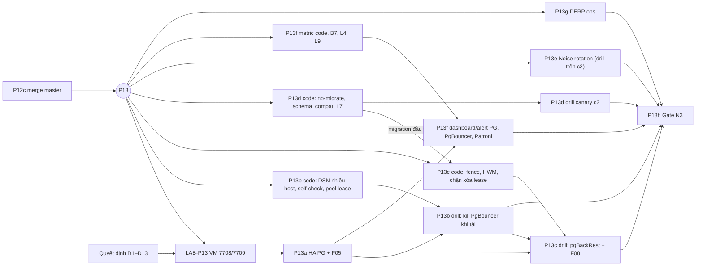

# P13 — Gate N3 (Operational): HA PostgreSQL, HA PgBouncer, backup/restore không lùi epoch, upgrade canary, xoay Noise key, giám sát và giới hạn

- **Trạng thái:** `Planned` (2026-11-26). Chưa có code. Các ADR 0011–0014 ở trạng thái **Proposed**, chờ chủ dự án (mục "Quyết định cần chủ dự án").
- **Nhánh kế hoạch:** `feat/P13-plan` (từ nhánh tích hợp `feat/P12c-review-hardening` `c9ba662`). Code: nhánh tích hợp `feat/P13-operational` (từ `master` sau khi P12c merge), mỗi ticket con một nhánh `feat/P13<x>-…`; không tự merge vào `master`.
- **Inventory:** `evidence/source-inventory-P13.md`.
- **ADR:** 0011 (PG HA + PgBouncer HA), 0012 (epoch floor / restore fence), 0013 (migration là bước riêng + tương thích schema), 0014 (xoay Noise key cluster). Liên quan: 0005, 0006, 0009, 0010.
- **Gate:** N3 (`PLAN.md` §7). Test: F05, F08 (`06-tests-benchmarks.md:38, 41`), kill PgBouncer khi đang tải, runbook đã diễn tập.
- **Phụ thuộc vào trước:** P12b (`Reviewed`, Gate N2 đạt); **P12c merge vào `master`** (P12c ghi "Chặn: P13"; B1/B2 lease và timeout là nền của F05).

## Mục tiêu (từ PLAN §7 N3)

1. HA PostgreSQL: primary + replica, failover đã diễn tập (F05), lease và `owner_epoch` không lùi.
2. HA PgBouncer: ≥ 2 instance; kill một instance khi đang tải → cluster tự nối lại, không owner kép, lease không lùi; sau failover PG chỉ gửi ghi tới primary mới; self-check cấu hình pooler khi khởi động.
3. Backup/restore không làm lùi `owner_epoch` hay epoch lease (F08).
4. Upgrade canary ở cấp cluster (standby trước).
5. Xoay Noise key cluster: runbook đã diễn tập; đo phạm vi ảnh hưởng; quy trình khẩn cấp.
6. DERP/STUN verified; queue/rate limit; giới hạn kết nối PG theo cluster; giám sát.

## Tổng quan ticket con

| ID | Việc | Thiết kế / ADR | Phụ thuộc | Ước lượng (ngày agent) | Song song với |
|---|---|---|---|---|---|
| LAB-P13 | Tạo `mc-pg-01`/`mc-pg-02` (plan đã lưu, create-only) | D1, D7 | D1, D7 | 0,5 | mọi phần code |
| P13a | HA PostgreSQL (Patroni + etcd, đồng bộ), chuyển `meshlab`, F05 | ADR 0011 §A–C, E | LAB-P13 | 5–7 | code P13b–P13f |
| P13b | HA PgBouncer, DSN nhiều host, pool lease, self-check pooler, kill khi tải | ADR 0011 §D, ADR 0006 | code: không; drill: P13a | 4–6 | P13c–P13f |
| P13c | Backup/restore (pgBackRest), epoch fence, chặn xóa lease, HWM trong process, F08 | ADR 0012 | code: không; drill: P13a, P13b; migration sau P13d | 6–8 | P13b, P13e, P13f |
| P13d | Upgrade canary: migration là bước operator, tương thích schema, L7 | ADR 0013 | migration đầu tiên của P13 | 5–7 | P13b, P13e, P13f |
| P13e | Xoay Noise key cluster: runbook, drill, khẩn cấp, sửa nhỏ | ADR 0014 | không | 3–4 | mọi ticket |
| P13f | Giám sát, cảnh báo, giới hạn kết nối PG theo cluster, rate limit (B7), L4/L9 | D9, D10 | metric code: không; dashboard đầy đủ: P13a/b | 6–9 | mọi ticket |
| P13g | DERP/STUN vận hành (relay lâu dài, verify-proxy, restart relay) | ADR 0009 (không đổi), D11 | không | 2–3 | mọi ticket |
| P13h | Gate N3: chạy lại mọi drill trên cây tích hợp, runbook, evidence | — | tất cả | 3–4 | — |

Tổng: **≈ 35–49 ngày agent**; với 3 làn song song và lab dùng chung (drill tuần tự), lịch dự kiến **3–5 tuần** (PLAN §11 cho N3–N4: 4–8 tuần). Đây là ước lượng, không phải cam kết.

## Đồ thị phụ thuộc

**Song song được ngay** (sau khi P12c vào `master`): code của P13b, P13c, P13d, P13e, P13f, P13g; LAB-P13 + P13a (infra). **Tuần tự bắt buộc:**
- migration: P13d (bảng `schema_compat`) **trước**, P13c (trigger chặn xóa lease, bảng `platform_epoch_fences`) sau và khai báo `compat` theo cơ chế mới. Chỉ một nhánh có migration tại một thời điểm;
- drill trên lab: một harness một lúc (mc-ci, client VM, c2 dùng chung). Thứ tự đề xuất: F05 → kill PgBouncer → canary → F08 → Noise rotation → relay restart → chạy lại tất cả ở P13h.
- Ticket chạm cùng file: P13b, P13c, P13f cùng sửa `hscontrol/types/config.go` + `tools/configgen` (option mới) và `internal/lease`: phân vùng rõ trong inventory từng ticket; merge theo thứ tự P13b → P13c → P13f.

---

## LAB-P13 — VM cho HA PostgreSQL

- **Phạm vi:** 2 VM mới, trong pool `meshcontrol-lab`, root OpenTofu riêng (bản nháp `infra/lab/drafts/p13-pg/main.tf`, chuyển sang `infra/lab/pg/` khi duyệt). Không đụng VM hiện có.

| VM | VMID | IP (vmbr0) | vCPU / RAM / đĩa | Vai trò |
|---|---|---|---|---|
| `mc-pg-01` | 7708 | 192.168.1.247 | 4 / 4 GiB / 60 GB `nvme01` | PostgreSQL 16 (Patroni), etcd, PgBouncer 1.24.1, HAProxy → `/primary` |
| `mc-pg-02` | 7709 | 192.168.1.248 | 4 / 4 GiB / 60 GB | như trên; khởi đầu là replica đồng bộ |
| `mc-db` (có sẵn) | 7704 | .243 | 4 / 8 GiB / 60 GB | etcd thứ 3 (witness), kho pgBackRest, Prometheus/Alertmanager/Grafana (D10). PG/PgBouncer docker cũ dừng sau khi chuyển `meshlab` |
| (dự phòng) | — | .249 | — | VIP keepalived nếu D3 chọn VIP; không cấp nếu chọn DSN nhiều host |

- **Mạng:** vmbr0 (cùng mạng với cluster VM hiện có), khác với đề xuất 10.77.40.x của `04-proxmox-lab.md` §3: cluster VM đang ở vmbr0 và host firewall `inet mclab` chặn lab VNet ↔ LAN nhà; đặt PG ở `mcsvc` cần đổi firewall host (người duyệt). nftables **trong** VM: 5432 chỉ từ hai node PG + mc-db (pgBackRest) + localhost; 6432 từ VM cluster (.241, .244–.246), mc-ci (.240), mc-bench (.242); 2379/2380 chỉ giữa ba thành viên etcd; 8008 chỉ từ localhost và mc-db (giám sát).
- **Plan đã lưu (không apply):** `fmt -check` 0, `validate` 0, `plan` → **4 to add, 0 to change, 0 to destroy** (2 snippet + VM 7708, 7709); `check-plan.py` exit 0 ("In lab scope"). Chi tiết: inventory §3.4. Plan chỉ create trong pool `meshcontrol-lab` và dải 7700–7799 ⇒ theo AGENTS rule 3 agent **được** tự apply, nhưng kế hoạch này giữ lại tới khi chủ dự án chốt D1/D7.
- **Kiểm tài nguyên host (đo 2026-11-26):** RAM 125,7 GiB, đang dùng 96,6 GiB, trống 26,8 GiB; RAM đã cấp cho VM đang chạy 116 GiB. Thêm 2 × 4 GiB → **124 / 125,7 GiB cấp phát** (sát; host vẫn chạy được vì nhiều VM dùng ít hơn mức cấp: mc-cp/c2/c1b/c2b dùng ~0,5 GiB mỗi VM, KSM chia sẻ 14,4 GiB). Dự kiến dùng thật thêm ~5–6 GiB → trống còn ~20 GiB. **Đủ, với điều kiện mc-bench (24 GiB) giữ tắt** khi cụm PG chạy; khi benchmark P14 cần tắt bớt VM khác hoặc tăng RAM PG tạm thời. Không đủ cho 2 × 8 GiB của PLAN §9 cùng lúc với mc-bench. CPU: 70 → 78 vCPU trên 36 thread, loadavg ≤ 2,1: đủ. Đĩa: `nvme01` trống 1629 GiB: đủ (kho backup trên mc-db: 54 GB trống, DB lab ~16 MB).
- **Rủi ro lab:** .247–.249 có thể nằm trong dải DHCP router (đặt reservation); lần tạo VM 7705 từng hỏng đĩa (nguyên nhân chưa rõ, `evidence/LAB-stage2a.md` §3): kiểm boot ngay sau apply; apply chạy nền, **không** bọc `timeout`.

---

## P13a — HA PostgreSQL (F05)

**Phạm vi**
- Script cài đặt idempotent `infra/lab/pg/setup-pg.sh` (+ cấu hình Patroni/etcd/HAProxy/PgBouncer dạng template, không secret): PGDG PostgreSQL 16, Patroni, etcd 3 thành viên (mc-pg-01, mc-pg-02, mc-db), `initdb --data-checksums`, `wal_log_hints`, watchdog `softdog`, `synchronous_mode: true` (không strict), `ttl 20 / loop_wait 5 / retry_timeout 5`, chrony.
- Role/secret: superuser, replication, `headscale` (đặt `idle_in_transaction_session_timeout = 5s` như `setup-db.sh`); mật khẩu sinh trên VM, nằm trong `%USERPROFILE%\.mesh-lab\mc-pg.env` và file 0600 trên VM; không trên dòng lệnh/log (AGENTS 2).
- Chuyển `meshlab` từ mc-db: dừng c2 lâu dài (quyền thường trực), `pg_dump -Fc` → `pg_restore` qua kết nối trực tiếp tới primary mới, kiểm `migrations` và số dòng, đổi config c2/c1 sang DSN mới, chạy lại; giữ container cũ dừng (không xóa volume) tới khi chủ dự án duyệt.
- Harness drill `infra/lab/e2e/p13/f05.sh` (dựa trên khung P11b/P12b: 2 cluster × active/standby, client VM thật A/B, tải ghi nhẹ qua đăng ký/đổi node + bench-db fence writes).
- Code: dự kiến **không** sửa đường nóng. Có thể cần: đọc lỗi kết nối khi primary đổi (pgx trả lỗi "read-only"/"terminating connection") để process thử lại thay vì tự fence quá sớm; chỉ sửa khi drill RED chứng minh.

**Test / drill (RED trước khi bật HA: chạy F05 trên cấu hình hiện tại = một PG, chứng minh control plane dừng hoàn toàn và không tự hồi phục khi container PG chết)**
- F05.1 `patronictl switchover` có kế hoạch; F05.2 `kill -9` postmaster của primary; F05.3 `qm stop`/dừng cứng VM primary (qua API, VM trong pool); F05.4 cắt mạng primary ↔ etcd và ↔ replica bằng nft **trong VM**; mỗi ca ×2, client 1.104.7 và 1.84.3.
- Đo và ghi: thời gian control plane dừng (từ sự cố tới `/ready` 200 và tới ping/`tailscale status` phục hồi), chuỗi `cluster_leases.epoch` và `owner_epoch` mỗi tailnet trước/sau (phải không giảm, không epoch nào có hai holder), số process tự fence, độ lệch đồng hồ hai node PG, ghi bị lỗi trong cửa sổ.
- Âm tính: sau F05.4 primary cũ (bị cô lập) không nhận ghi nào được commit (watchdog/demote); PgBouncer không gửi ghi tới replica (đếm lỗi `read-only` = 0 sau khi HAProxy chuyển).

**Nghiệm thu**
- F05 mọi ca PASS ×2; không owner kép; epoch không lùi; client không đăng nhập lại; thời gian dừng ≤ ngưỡng D12.
- Runbook `docs`-ngoài-mkdocs (đặt ở `infra/lab/pg/RUNBOOK.md`): failover tự động, switchover, promote cưỡng bức (kèm fence ADR 0012), dựng lại replica (`patronictl reinit`), thay node.
- Evidence `evidence/P13a-pg-ha.md`.

**Điều kiện dừng**
- Drill thấy epoch lùi hoặc hai holder cùng epoch, hoặc ghi được commit trên primary cũ sau khi replica đã promote → dừng, báo (isolation/fencing = BLOCK, AGENTS 13).
- RAM host trống < 8 GiB khi chạy đủ → dừng, báo (không tự tắt VM ngoài lab).

---

## P13b — HA PgBouncer

**Phạm vi (code)**
- `PostgresConfig`: danh sách host (`hosts: ["a:6432","b:6432"]` hoặc `host` có dấu phẩy, chốt trong inventory), `target_session_attrs` (mặc định `read-write` ở cluster mode), `connect_timeout`, keepalive; `DSN()` sinh đúng URL nhiều host của pgx; tài liệu cấu hình qua `tools/configgen`, `nix/options.generated.nix`.
- DSN/pool thứ hai cho lease (`database.postgres.lease_dbname` hoặc tương đương, alias `mesh_lease`), `LeaseStore()` dùng pool đó (ADR 0006 §3.6).
- Self-check pooler khi mở (ADR 0006 §3.5): câu có tham số hai lần, `SHOW transaction_read_only`; thông báo lỗi rõ; thay thông báo gây hiểu nhầm hiện tại.

**Phạm vi (lab)**
- PgBouncer trên mc-pg-01/02 → HAProxy cục bộ → `/primary`; `[databases]`: `*` (pool dữ liệu), `mesh_lease` (pool lease), và alias theo cluster nếu D9b chọn (P13f).

**Test RED**
- PgBouncer thật (container tạm trên mc-ci) `max_prepared_statements = 0` → hôm nay `ErrDatabaseUnavailable`/thông báo sai (RED) → lỗi pooler rõ ràng.
- DSN hai host, host 1 tắt → mở được qua host 2; host 1 trả `read_only = on` (PG replica sau PgBouncer) → pgx bỏ qua, nối host 2.
- Lease qua pool riêng: pool dữ liệu bão hòa (bench-db) → renew p99 không tăng như B2 (651 ms) — so trước/sau.

**Drill**
- Kill -9 PgBouncer trên node đang nhận phần lớn kết nối, khi đang tải (bench-db fence writes + client thật): đo thời gian lỗi ghi, số process tự fence (mục tiêu 0: renew phải qua host kia trong < 8 s), epoch không lùi, không owner kép. Lặp với `systemctl stop` (đóng sạch) và với chặn mạng 6432 (không RST).
- Sau F05: không có câu ghi nào tới replica (log PG replica), PgBouncer hai node cùng trỏ primary mới.

**Nghiệm thu:** test RED → GREEN; drill ×2 PASS theo ngưỡng D12; evidence `evidence/P13b-pgbouncer-ha.md`.
**Điều kiện dừng:** pgx không hỗ trợ ngữ nghĩa nhiều host qua PgBouncer như giả định 2 của inventory → dừng, đề xuất VIP (phương án dự phòng D3).

---

## P13c — Backup/restore, epoch không lùi (F08)

**Phạm vi**
- pgBackRest: repo trên mc-db (posix, `repo1-cipher-type = aes-256-cbc`, passphrase ngoài repo Git), `archive_command` async từ primary (Patroni), full hằng tuần + diff hằng ngày + WAL liên tục (lab: lịch rút ngắn), `pgbackrest check`/`verify`; `create_replica_methods: [pgbackrest, basebackup]`.
- Code (ADR 0012): lệnh fence (`mesh-placement epoch-fence --reason …`, kết nối trực tiếp, operator mTLS hoặc chạy cục bộ), migration trigger chặn `DELETE` trên `cluster_leases` + bảng `platform_epoch_fences`; HWM trong `lease.Manager` (bộ nhớ + file tùy chọn), reconcile không nạp lại tenant có `owner_epoch` nhỏ hơn runtime.
- Runbook restore: PAUSE/DISABLE PgBouncer → restore (PITR) → fence → kiểm → RESUME; restore thử định kỳ sang DB tạm (kiểm backup dùng được).

**Test RED** (theo ADR 0012 §Kiểm chứng)
- Restore mô phỏng trên PG (DB template): manager với HWM cũ → hôm nay acquire ở epoch thấp (RED) → từ chối tới khi fence.
- `DELETE FROM cluster_leases` → hôm nay thành công (RED) → lỗi.
- Reconcile: `owner_epoch` giảm → hôm nay nạp lại (RED) → không nạp lại.
- Fence: mọi epoch ≥ floor, đơn điệu khi chạy lại, move đang chờ bị hủy, trigger cho phép; số epoch lớn hiển thị đúng ở CLI/API/log.

**Drill F08:** backup B → F01 trên c1 (lease +1) → move tailnet c1 → c2 (owner_epoch +1) → restore về B (PITR trước hai việc) → fence → khởi động lại: chuỗi epoch đo được; process trước restore (còn sống) bị chặn trước fence; sau fence không process/cluster nào nhận quyền cũ (c2 từ chối tailnet đã "quay về" c1; ghi của holder trước restore `ErrFenced`); client không đăng nhập lại trừ các client đã đăng nhập lại sau điểm B (ghi số).

**Nghiệm thu:** RED → GREEN; F08 ×2 PASS; backup/restore thử thành công có số đo thời gian; evidence `evidence/P13c-backup-restore.md`.
**Điều kiện dừng:** fence không thể chạy trong một transaction với khóa hợp lý trên DB lab (khóa lâu, deadlock với runtime) → dừng, báo; mọi phát hiện epoch lùi sau fence → BLOCK.

---

## P13d — Upgrade canary theo cluster

**Phạm vi (ADR 0013)**
- Cluster mode và CLI live **không** migrate; `mesh-placement migrate` dưới khóa (sửa L7); bảng `schema_compat` + phân loại `expand`/`contract`; `checkV01Database` và `OpenReadOnly` dùng quy tắc tương thích, thông báo đúng nguyên nhân.
- Runbook upgrade: backup → migrate (expand) → bootstrap/placement → mỗi cluster: standby → switchover → active; canary = c2; khoảng quan sát; rollback.
- Lệnh switchover có kiểm soát (SIGTERM active, chờ standby `/ready` 200) trong harness; đo gián đoạn.

**Test RED:** theo ADR 0013 §Kiểm chứng (cluster tự migrate; binary N từ chối DB có expand mới; hai migrate đồng thời → một bên thoát).
**Drill:** trên c2 với build N (cây tích hợp) và N+1 (cùng cây + một migration `expand` vô hại **chỉ cho drill**, không merge): bước nào cũng có client thật ping liên tục; rollback standby về N; đo.
**Nghiệm thu:** RED → GREEN; drill ×2; không đăng nhập lại; evidence `evidence/P13d-canary-upgrade.md`.
**Điều kiện dừng:** cần sửa/reorder migration đã commit (AGENTS 11) → dừng.

---

## P13e — Xoay Noise key của cluster

**Phạm vi (ADR 0014):** runbook có kế hoạch + khẩn cấp; CLI xoay có kiểm định dạng; active kiểm lại registry key mỗi chu kỳ reconcile và nhả lease khi lệch; không tự tạo key khi registry đã có key.
**Test RED:** sửa registry khi active giữ lease → hôm nay active phục vụ tiếp (RED); file key thiếu → hôm nay tự tạo (RED); `PATCH` key sai định dạng → hôm nay 200 (RED).
**Drill:** c2 (mc-c2/mc-c2b), ≥ 2 tenant, client 1.104.7 + 1.84.3 (VM A/B và container): thời gian phục hồi từng client, tỉ lệ tự phục hồi không restart theo thời gian, có phải đăng nhập lại không, NodeID/IP giữ nguyên; client trên c1 không bị ảnh hưởng; drill khẩn cấp (bỏ thông báo) đo cùng chỉ số.
**Nghiệm thu:** RED → GREEN; drill ×2; số đo phạm vi ảnh hưởng ghi vào ADR 0014 §Hệ quả; evidence `evidence/P13e-noise-rotation.md`.
**Điều kiện dừng:** client không hồi phục kể cả sau restart `tailscaled`, hoặc phải đổi cách xử lý handshake phía server (nhiều key) → dừng, ghi ADR, log protocol đã redact (AGENTS 12).

---

## P13f — Giám sát, cảnh báo, giới hạn

**Phạm vi (code)**
- Metric cluster: lease (`lease_held`, epoch hiện tại, độ trễ renew, số lần acquire/lose/self-fence, regression), fence (`ErrFenced` theo lý do), pool DB (`sql.DBStats` cho pool dữ liệu và pool lease), reconcile; L4 (cấp nhãn tailnet chỉ sau khi kiểm tailnet được phục vụ); L9 (reload policy lỗi: metric + không ghi revision đã áp).
- `mesh-bootstrap`, `mesh-placement`: listener metric riêng, hạn chế CIDR như cluster (AGENTS 9), `/health` cho placement.
- B7: per-IP cho bootstrap và listener cluster dựa trên PROXY protocol v2 từ đường công khai (nếu D9a chọn): listener chỉ chấp nhận header PROXY từ danh sách nguồn tin cậy, thiếu/sai → từ chối; bật `-ip-rate` mặc định khác 0 khi có IP thật; giới hạn đồng thời/tốc độ cho `/ts2021`, `/key`, `/verify`. Nếu D9 chọn không đổi VPS: chỉ ghi rủi ro, giữ bucket toàn cục + theo tenant.
- Giới hạn kết nối PG theo cluster (không có role theo cluster, ADR 0005): alias PgBouncer theo cluster (`mesh_c1`, `mesh_c2`, … cùng DB vật lý) với `pool_size`/`max_db_connections` riêng + `max_open_conns` phía Go; PG `max_connections` = tổng pool + reserve + replication + superuser.

**Phạm vi (lab):** Prometheus + Alertmanager + Grafana (container, pin version) trên mc-db; exporter: node, postgres_exporter, pgbouncer_exporter, Patroni `/metrics`, etcd, pgBackRest (script textfile), derper (`/debug/varz` qua localhost); dashboard JSON trong repo (`infra/lab/monitoring/`).

**Cảnh báo tối thiểu (mỗi cái có test làm nó bắn trong drill):** cluster không có holder > TTL; tần suất takeover (flapping); fence error rate; epoch regression; PgBouncer `cl_waiting > 0` > 30 s, `maxwait`; Patroni không có leader / không có sync standby; lag replica; WAL archive lỗi; backup cũ hơn 26 h; lệch đồng hồ PG > 100 ms; đĩa > 80 %; cert TLS (cluster, relay) < 14 ngày; tenant ≥ 80 % quota; nhãn tailnet gần trần.

**Test RED:** metric lease/fence/pool chưa có (RED: scrape không thấy); L4 (RED: request tới tailnet không phục vụ vẫn tiêu nhãn); L9 (RED: revision ghi là đã áp khi reload lỗi); B7 (RED: 1 IP flood bootstrap làm tenant khác 429, nếu D9a).
**Nghiệm thu:** RED → GREEN; dashboard cho mọi drill P13a–e (ảnh chụp đã redact, không IP/node key thật của client); evidence `evidence/P13f-monitoring-limits.md`.
**Điều kiện dừng:** endpoint metric/debug lộ node/IP/key trên listener công khai → BLOCK (AGENTS 9).

---

## P13g — DERP/STUN cho N3

**Đã có (N1, `Verified`, chủ dự án duyệt):** ADR 0009; `/verify` cluster mode fail closed; S15 qua E2E N1 (relay 901/902 trên `mc-relay`, từ chối node lạ/đã thu hồi, sau F01 vẫn chấp nhận client mới); phương án (a) cho client 1.84.3.

**Còn lại cho N3:**
- `derper` chỉ chạy trong lượt E2E với secret theo lượt; config lâu dài (`meshlab`) vẫn dùng DERP công cộng (ADR 0009 §4). Cần: unit systemd lâu dài cho 901/902, secret lâu dài mỗi cluster (xoay được), quyết định D11 cho `meshlab`.
- Secret nằm trong argv của `derper` (ADR 0009 §Hệ quả): verify-proxy cục bộ trên `mc-relay` (127.0.0.1, đọc secret từ file 0600, chuyển tiếp tới URL cluster) để argv không chứa secret.
- Drill "restart relay" (`04-proxmox-lab.md` §8): restart derper/VM relay khi client đang dùng DERP; đo thời gian quay lại; client không mất peer quá ngưỡng.
- Verify khi PG failover (F05): relay từ chối client **mới** trong lúc control plane dừng (fail-open=false), giữ kết nối cũ; ghi số đo trong F05.
- Cert relay: gia hạn tự động (hiện chép tay từ mc-cp).
- Một relay VM = điểm lỗi đơn của DERP lab; HA relay (nhiều node mỗi region) để P14/N4 nếu cần, ghi rủi ro.
**Nghiệm thu:** S15 chạy lại trên relay lâu dài; drill restart relay ×2; `ps` trên relay không thấy secret; evidence `evidence/P13g-derp-ops.md`.

---

## P13h — Gate N3

- Chạy lại trên cây tích hợp `feat/P13-operational`: F05, kill PgBouncer, F08, canary, Noise rotation, restart relay; cộng E2E N1 (ít nhất ON + 1.104.7 và OFF + 1.84.3) và E2E P12b 13/13 trên cụm PG HA (hồi quy).
- Race toàn repo + `p05cluster`, lint, CI xanh.
- `evidence/N3-gate.md`: bảng điều kiện N3 → bằng chứng; runbook đã diễn tập (PLAN §12): failover và restore PostgreSQL, restart cluster, xoay Noise key, upgrade.

---

## Phân bổ các mục còn lại từ review 2026-11-26

| ID | Đã xử lý ở | P13 |
|---|---|---|
| B7 (flood bootstrap, IP bị che) | — | P13f (D9) |
| L1, L2, L7 | P12c (L7: chỉ ghi kết quả move) | L7 phần "hai process cùng migrate một bên thoát": P13d |
| L3 (PRAGMA `query_only` SQLite) | — | Ghi tài liệu (chỉ dev/SQLite; bootstrap production dùng PG). Sửa nhỏ nếu rẻ: đặt qua DSN `_pragma=query_only(1)` cho mọi kết nối — P13f, ưu tiên thấp |
| L4 (nhãn metric tiêu trước khi kiểm) | — | P13f |
| L5 (không thu hồi chứng chỉ operator) | — | P13f: chứng chỉ operator ngắn hạn + runbook xoay CA/cert; CRL/OCSP để N5 |
| L6 (self-fence dựa CLOCK_MONOTONIC, giờ DB) | — | P13a (chrony, cảnh báo lệch, ghi trong F05); P13f cảnh báo |
| L8 (ghi chú thiết kế) | — | Chỉ tài liệu (runbook vận hành) |
| L9 (reload lỗi vẫn ghi revision) | — | P13f |
| L10 phần còn lại (`.After` chuỗi; `createDefaultTailnet` không qua PENDING) | P12c một phần | P13f nhóm "dọn" nếu không đụng đường nóng; `createDefaultTailnet` chỉ dev/single-tenant: kiểm không có đường gọi ở cluster mode, thêm test |

---

## Quyết định cần chủ dự án (kèm đề xuất)

| # | Câu hỏi | Đề xuất của agent |
|---|---|---|
| D1 | Cơ chế failover PostgreSQL: Patroni + etcd, pg_auto_failover, repmgr, hay promote thủ công có script? | **Patroni + etcd 3 thành viên** (mc-pg-01, mc-pg-02, mc-db làm witness), watchdog softdog (ADR 0011 §A) |
| D2 | Sao chép đồng bộ hay bất đồng bộ? Strict hay không? | **Đồng bộ, không strict** (`synchronous_mode: true`, `strict: false`): failover thường không mất commit nên epoch không lùi; khi replica chết primary vẫn ghi; promote cưỡng bức sau đó buộc chạy fence (ADR 0012) |
| D3 | Client tới PgBouncer: danh sách host trong DSN (sửa code) hay VIP keepalived (.249)? | **Danh sách host + `target_session_attrs=read-write`**; PgBouncer → HAProxy cục bộ → `/primary`. VIP là dự phòng |
| D4 | An toàn epoch sau restore: epoch floor theo thời gian + HWM trong process + chặn xóa lease (ADR 0012)? Fence tự động sau **mọi** failover Patroni (D4b)? | **Có** cho ADR 0012; **D4b: không** (chỉ fence khi restore/promote cưỡng bức; F05 phải chứng minh epoch không lùi khi failover đồng bộ) |
| D5 | Công cụ backup? | **pgBackRest**, repo trên mc-db, mã hóa, full tuần + diff ngày + WAL liên tục; WAL-G cần object storage (lab không có) |
| D6 | Migration: process cluster thôi tự migrate; `mesh-placement migrate` + phân loại expand/contract (ADR 0013)? | **Có**. Đổi hành vi khởi động hiện nay: thêm một bước vận hành khi upgrade |
| D7 | Kích thước và chỗ đặt VM PG trên lab; chuyển `meshlab` sang cụm mới (c2 lâu dài dừng một lúc)? | **4 vCPU / 4 GiB / 60 GB × 2** (7708 .247, 7709 .248, vmbr0); mc-bench giữ tắt khi cụm chạy; chuyển `meshlab` bằng dump/restore trong cửa sổ báo trước; container cũ dừng, không xóa |
| D8 | Xoay Noise key: chấp nhận xoay "lạnh" (switchover, client có thể phải restart `tailscaled`) và không làm hai key chồng lấn? Thêm kiểm registry key định kỳ (active nhả lease khi lệch)? | **Có / không chồng lấn / có kiểm định kỳ** (ADR 0014). Chồng lấn hai key là đổi mô hình Noise, cần ADR riêng do chủ dự án mở |
| D9 | B7 per-IP: (a) PROXY protocol v2 trên đường công khai (thay `systemd-socket-proxyd` trên VPS và mc-cp bằng HAProxy, **đổi dịch vụ trên VPS dùng chung**); (b) giữ nguyên, ghi rủi ro. D9b: giới hạn kết nối PG theo cluster bằng alias PgBouncer theo cluster? | **(a)**, nếu chủ dự án cho phép đổi VPS (một dòng báo trước theo quyền thường trực; rollback = khôi phục unit cũ); **D9b: có** |
| D10 | Chỗ chạy Prometheus/Alertmanager/Grafana? | **Container trên mc-db** (không cần VM/IP mới); VM `mc-mon` riêng nếu muốn tách, cần IP (.249 hoặc VNet) |
| D11 | DERP: relay lâu dài + verify-proxy cục bộ (secret ra khỏi argv)? Config lâu dài `meshlab` chuyển sang relay riêng? | **Có / có** (giữ DERP công cộng chỉ cho POC) |
| D12 | Ngưỡng nghiệm thu drill (như Q7 của P12b) | F05: control plane phục hồi ≤ **45 s** (Patroni ttl 20 s + lease 10 s + nạp), ping gap ≤ 10 s, epoch không lùi, 0 can thiệp tay; kill PgBouncer: **0** cluster failover, lỗi ghi ≤ 10 s; F08: 0 quyền cũ sau fence, phục hồi ≤ 5 phút sau restore; canary: mỗi switchover ≤ 15 s; Noise rotation: **đo và báo cáo** (chưa đặt ngưỡng vì phụ thuộc client, D8) |
| D13 | Thứ tự merge: P12c vào `master` trước khi bắt đầu code P13? | **Có** (P12c ghi "Chặn: P13"; F05 dựa trên B1/B2) |

## Rủi ro

1. **Đồng hồ sau failover PG:** lease đo bằng `now()` của primary mới; lệch > safety margin (2 s) mở khe hai process cùng phát netmap từ bộ nhớ (ghi vẫn bị fence). Giảm bằng chrony + cảnh báo + ghi độ lệch trong F05.
2. **RAM host sát:** cấp phát 124 / 125,7 GiB sau khi thêm VM; mc-bench không chạy cùng lúc được; VM non-lab 101 dùng 28,9 GiB và không được đụng.
3. **Mọi VM trên một host:** HA trên lab không kiểm lỗi phần cứng/host; Proxmox VM isolation không thay cho kiểm logic (AGENTS).
4. **Fence làm mọi cluster nạp lại mọi tailnet** (reconnect storm nhỏ sau restore); lần fence đầu nhảy epoch lên ~1,9·10¹⁵: kiểm hiển thị/log.
5. **Xoay Noise key có thể buộc restart client** (chưa đo); key lộ: client chưa restart vẫn tin key cũ và TLS `/ts2021` không được client enforce.
6. **pgx nhiều host qua PgBouncer** chưa kiểm; nếu không như giả định, chuyển VIP (D3).
7. **Thay đổi hành vi khởi động (ADR 0013)** làm vận hành cần thêm bước migrate; quên bước → cluster từ chối khởi động (fail closed, thông báo rõ).
8. **Đổi VPS cho PROXY protocol (D9a)** chạm dịch vụ dùng chung ngoài lab; cần rollback rõ ràng.
9. **Lab bận:** một E2E tại một thời điểm; drill P13 tuần tự là đường găng thật, không phải code.
10. **Số ADR 0011–0014** có thể đụng với ADR mới trên nhánh song song (`feat/P14-plan`): kiểm trước khi merge, đổi số nếu cần.
11. **Bản nháp IaC** dùng IP .247/.248 có thể nằm trong dải DHCP router; ổ đĩa VM mới từng hỏng một lần (7705) khi tạo.

## Ngoài phạm vi

- Reconnect/failover storm, quota theo lớp shard, SLO, PG/PgBouncer dưới tải lớn: P14.
- HA relay nhiều node mỗi region, DR khác host/site, CRL/OCSP cho operator: N4/N5.
- Đổi mô hình Noise (nhiều key), RLS, role DB theo cluster: không làm (ADR 0005).
